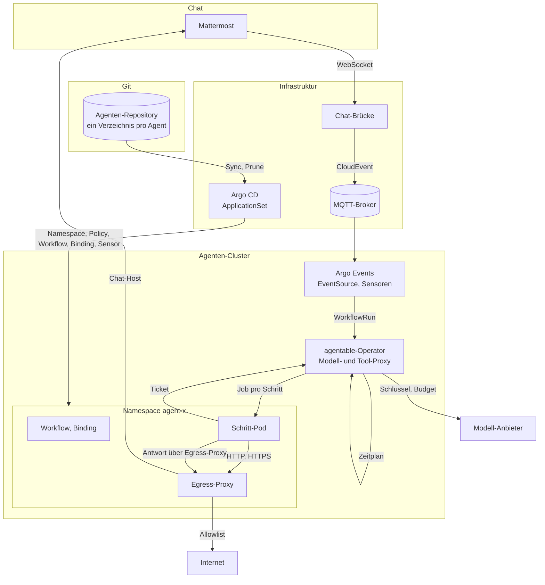
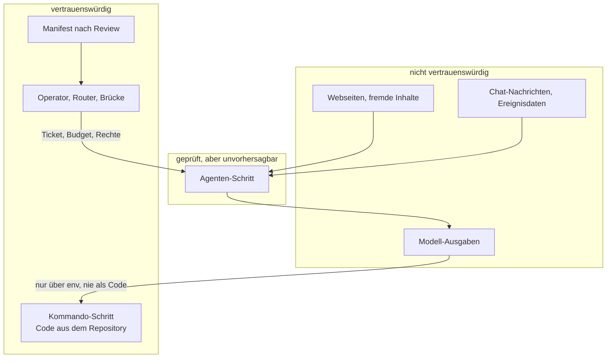
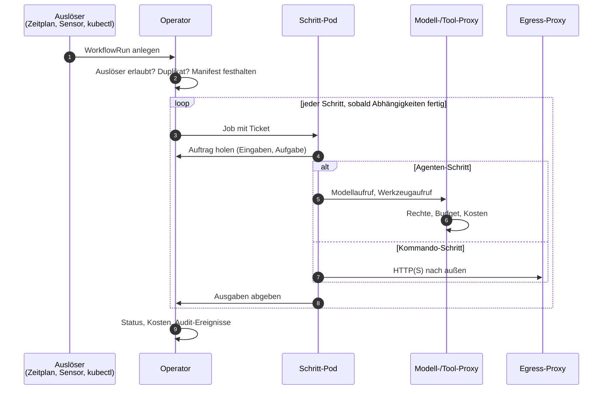

# 01 Architektur im Überblick

## Das Gesamtbild

Lesart von links nach rechts:

1. **Git:** Jeder Agent ist ein Verzeichnis im Agenten-Repository: AWP-Manifest(e) und eine Werte-Datei für die Laufzeit.
2. **Bereitstellung:** Ein ApplicationSet in Argo CD macht aus jedem Verzeichnis eine Application. Sie legt den Namespace des Agenten an, seine NetworkPolicy, seinen Egress-Proxy, das Manifest, die Binding und den Ereignis-Sensor ([Kapitel 05](05-bereitstellung.md)).
3. **Ereignisse:** Eine kleine Brücke hört im Chat mit und veröffentlicht jede Nachricht als CloudEvent auf einem MQTT-Broker. Argo Events filtert deterministisch und legt einen Lauf an ([Kapitel 06](06-ereignisse.md)). Zeitpläne erzeugt der Operator selbst.
4. **Ausführung:** Der Operator prüft den Lauf, startet jeden Schritt als eigenen Pod und gibt ihm ein Ticket. Der Pod hat keinen Kubernetes-Token und keinen Modell-Schlüssel ([Kapitel 04](04-laufzeit.md)).
5. **Türen nach außen:** Modell- und Werkzeugaufrufe gehen über den Operator (Budget, Rechte, Schlüssel), sonstiger HTTP-Verkehr über den Egress-Proxy des Agenten (Allowlist von Domains, [Kapitel 08](08-isolation-und-netzwerk.md)).
6. **Ergebnis:** Der letzte Schritt schreibt in den Chat, im Thread der auslösenden Nachricht oder als Meldung in einen Kanal ([Kapitel 07](07-kanaele.md)). Im PoC geht das noch direkt, im Agenten-Cluster über den Egress-Proxy.

## Zwei Arten von Schritten

Jeder Workflow besteht aus Schritten, und es gibt genau zwei Arten. Ein **Agenten-Schritt** lässt ein Sprachmodell eine Aufgabe bearbeiten: unvorhersagbar, ohne Zugangsdaten, nach außen nur über den Operator. Ein **Kommando-Schritt** führt festen Code aus dem Repository in einem Container aus: vorhersagbar, darf Secrets bekommen, nach außen nur über den Egress-Proxy. Faustregel: **Denken im Agenten, Handeln im Kommando.** Details in [Kapitel 03](03-workflow-manifest.md#zwei-arten-von-schritten).

## Komponenten

| Komponente | Aufgabe | Läuft wo | Stand |
| --- | --- | --- | --- |
| Agenten-Repository | Manifeste, Werte, Werkzeug-Skripte, Tests pro Agent | Git | umgesetzt |
| Charts `agent-lib`, `agent`, `mattermost-chat` | übersetzen Werte in Namespace, Policy, Binding, Sensor | Agenten-Repository | umgesetzt |
| Argo CD mit ApplicationSet | ein Verzeichnis wird eine Application, entfernt wird gelöscht | Infrastruktur-Cluster (lokal: im selben Cluster) | umgesetzt |
| agentable-Operator | prüft Manifeste, Zeitpläne, Läufe, startet Schritte, Proxys, Budgets, Audit | Agenten-Cluster, Namespace `agentable-system` | umgesetzt |
| agentable-Runner | führt einen Schritt aus: Tool-Schleife (Agent) oder Wrapper (Kommando) | Schritt-Pod | umgesetzt |
| Chat-Brücke | Chat-Nachrichten als CloudEvents auf MQTT | im PoC neben dem Operator, endgültig offen (O10) | umgesetzt |
| MQTT-Broker | interner Ereignis-Bus mit ACLs | Infrastruktur-Cluster | umgesetzt |
| Argo Events | EventSource (MQTT), EventBus, ein Sensor pro Workflow | Agenten-Cluster, Namespace `agent-events` | umgesetzt |
| Egress-Proxy | Squid pro Agent, Allowlist von Domains | Namespace des Agenten | umgesetzt |
| Runtime-Image | generisches Image für Kommando-Schritte (Python, jq, Antwort-Skript) | Registry | umgesetzt |
| Freigaben, Rückfragen im Lauf | Knöpfe im Chat, Lauf wartet | Operator plus Brücke | geplant |
| MCP-Werkzeuge | Werkzeugquellen über den Tool-Proxy | Operator | geplant |

## Vertrauensgrenzen

- **Fremde Inhalte und Ereignisdaten** gelten immer als nicht vertrauenswürdig, auch wenn der Absender authentifiziert ist. Eine Chat-Nachricht von einem berechtigten Benutzer kann trotzdem Text enthalten, den er von einer Webseite kopiert hat.
- **Agenten-Schritte** sind geprüft (Manifest im Review, Rechte im Proxy), aber unvorhersagbar. Sie dürfen nur, was das Manifest erlaubt, und das nur über den Proxy.
- **Kommando-Schritte** führen Code aus dem Repository aus. Ausgaben von Agenten kommen nur als Umgebungsvariablen an, nie als Teil des Kommandos.
- **Operator, Router und Brücke** entscheiden ohne Modell.

Mehr dazu in [Kapitel 14](14-sicherheit.md).

## Ablauf eines Laufs

