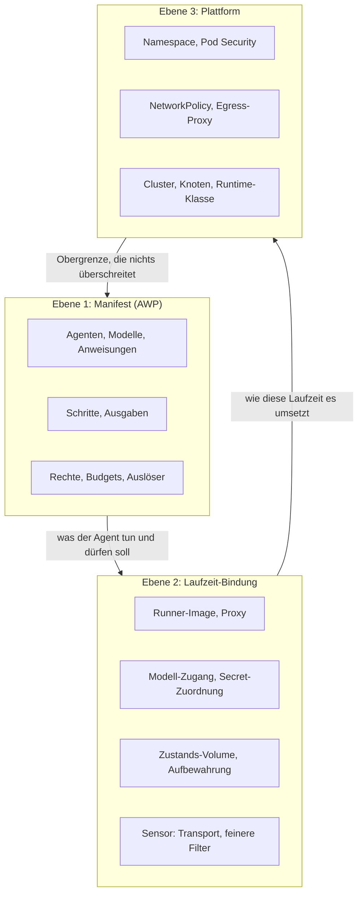

# 02 Drei Ebenen der Konfiguration

Die wichtigste Entscheidung des Konzepts ist, wo eine Einstellung steht. Drei Ebenen, drei Verantwortliche, drei Prüfwege.

| | Ebene 1: Manifest | Ebene 2: Laufzeit-Bindung | Ebene 3: Plattform |
| --- | --- | --- | --- |
| Frage | Was tut der Agent, was darf er? | Wie läuft er in dieser Laufzeit? | Wo läuft er, mit welchen Grenzen? |
| Objekte | AWP `Workflow` | `WorkflowBinding`, Sensor | Namespace, NetworkPolicy, Egress-Proxy, Cluster |
| Portabel | ja, zwischen Laufzeiten | nein, gehört zu agentable | nein, gehört zum Betreiber |
| Geschrieben von | Fachseite, oft mit einem Assistenten | Werte-Datei im Agenten-Verzeichnis | Charts der Plattform |
| Geprüft durch | Review, JSON-Schema, `awp-check`, Operator | Chart-Tests, Operator | Chart-Tests, Admission (Pod Security) |
| Im Digest des Manifests | ja | nein | nein |
| Beispiel | `budget.maxCostUsd: 0.5` | `state.claimName: scout-state` | `egress.mode: proxy` |

## Regeln

1. **Das Manifest enthält keine Laufzeit-Begriffe.** Kein Namespace, kein Image-Pull-Secret, kein Volume-Name, keine Kubernetes-Secret-Namen. Ein Secret heißt im Manifest `CHAT_BOT_TOKEN` und hat einen `scope`; welches Kubernetes-Secret dahintersteht, sagt die Binding.
2. **Untere Ebenen dürfen nur enger machen.** Erlaubt das Manifest `api.example.org`, darf der Egress-Proxy nichts hinzufügen. Verlangt das Manifest mehr, als die Plattform hergibt, wird der Workflow abgelehnt, statt still beschnitten zu laufen. Filtert das Manifest Ereignisse auf einen Absender, darf der Sensor enger filtern, nie weiter.
3. **Die Plattform ist die Obergrenze.** Ein Manifest kann nicht mehr Netzwerk, mehr Rechte oder mehr Ressourcen bekommen, als Namespace und Policy hergeben. Ein fehlerhaftes oder manipuliertes Manifest kann die Plattform nicht öffnen.
4. **Wer ändert, prüft auf seiner Ebene.** Eine neue Domain im Manifest ist eine fachliche Änderung im Review; eine neue Domain in der Allowlist des Proxys ist eine Betriebsänderung. Beide sind Pull Requests, aber mit anderem Blick.

## Durchsetzung heute

Die Regeln sind das Ziel; der PoC setzt sie nur teilweise durch:

| Regel | Stand |
| --- | --- |
| Manifest ohne Laufzeit-Begriffe | umgesetzt (CI prüft `metadata.namespace`), bis auf `secrets[].source: kubernetes` |
| Sensor filtert nur enger als das Manifest | offen: niemand prüft es, und die Laufzeit sieht die Ereignisdaten nicht |
| Plattform als Obergrenze | teilweise: Egress-Modus und Domains stehen in der `values.yaml` des Agenten. Eine Richtlinien-Prüfung in der CI erlaubt dort nur `egress.mode`, `proxy.enabled` und `proxy.allowedDomains` (keine Squid-Regeln, keine breiten Netze, kein Runner-Image, kein Modell-Zugang), CODEOWNERS verlangt den Review des Betreibers, und ein Argo-CD-AppProject erlaubt nur `agent-*`-Namespaces und die Objektarten der Charts (umgesetzt). Eine Obergrenze für Domains außerhalb des Agenten-Verzeichnisses fehlt noch (O02) |

## Warum nicht alles ins Manifest

Es wäre bequem, Netzwerkregeln, Volumes und Images im Manifest zu haben: eine Datei, alles drin. Drei Gründe dagegen:

- **Portabilität.** Dasselbe Manifest soll auf dem Laptop, in einem anderen Cluster oder in einer anderen Laufzeit laufen ([Kapitel 16](16-ohne-kubernetes.md)). Kubernetes-Begriffe im Manifest machen das unmöglich.
- **Trennung der Verantwortung.** Wer einen Agenten fachlich beschreibt, soll nicht über Volumes und Secret-Namen entscheiden müssen, und wer die Plattform betreibt, soll Grenzen setzen können, ohne Manifeste anzufassen.
- **Sicherheit.** Ein Manifest wird oft von einem Assistenten geschrieben. Wenn es seine eigenen Grenzen festlegen könnte, wäre jede Grenze nur so gut wie der Review.

## Doppelte Angaben sind gewollt

Manche Dinge stehen auf zwei Ebenen: Das Manifest sagt "dieser Workflow braucht `www.example.org`" (`permissions.network`), der Egress-Proxy lässt `www.example.org` durch. Das ist keine Verdopplung, sondern Anspruch und Zusage. Wie die Allowlist künftig aus dem Manifest abgeleitet wird, steht in [Kapitel 08](08-isolation-und-netzwerk.md#woher-die-allowlist-kommt).
