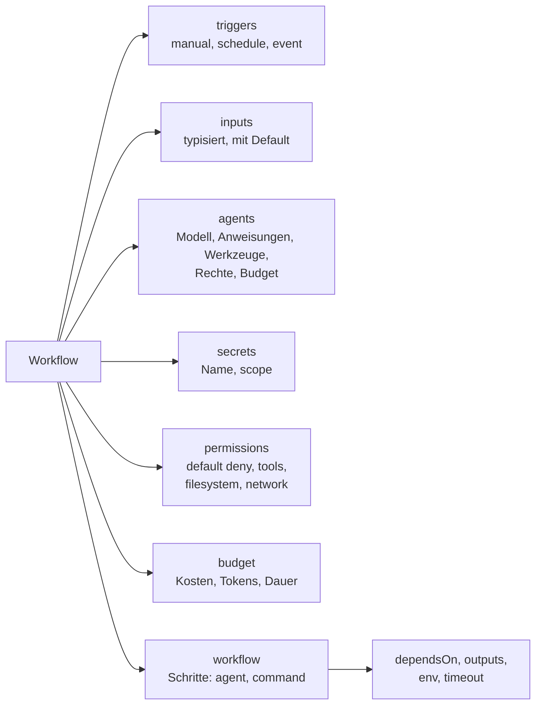

# 03 Workflow-Manifest (AWP)

## Warum ein offenes Format

Agenten werden selten von Hand geschrieben. Meist beschreibt jemand den Anwendungsfall, und ein Assistent formuliert das Manifest. Damit das sicher ist, braucht es ein Format mit veröffentlichtem Schema, einem Prüfwerkzeug für die CI und klarer Bedeutung jedes Felds. Das [Agentic Workflow Protocol](https://agenticworkflowprotocol.org) (AWP) bietet das: eine Spezifikation, keine Engine. Seit `v1alpha2` sind AWP-Manifeste gültige Kubernetes-Ressourcen (`awp.agenticworkflowprotocol.org/v1alpha2`, Kind `Workflow`); dieselbe Datei geht durch `kubectl apply --validate=strict` und durch `awp-check`.

Die Laufzeit (hier agentable) führt Manifeste aus, erfindet aber kein eigenes Format. Fehlt etwas, wird es an die Spezifikation gemeldet ([Abgleich mit AWP](awp-abgleich.md)).

## Aufbau



| Teil | Inhalt | Beispiel |
| --- | --- | --- |
| `triggers` | wann ein Lauf starten darf | `schedule` mit Cron und Zeitzone; `event` mit `source`, `eventType`, `filter` |
| `inputs` | Parameter eines Laufs | Liste der Quellen, Thread-ID, Nachricht |
| `agents` | wer denkt: Modell, Anweisungen, Werkzeuge, eigene Rechte und Budgets | Sammler mit kleinem Modell und `web.fetch`, Kurator mit größerem Modell ohne Werkzeuge |
| `secrets` | welche Geheimnisse es gibt und welche Schrittart sie sieht | `MATTERMOST_BOT_TOKEN` mit `scope: [command]` |
| `permissions` | was erlaubt ist, Standard ist verboten | `shell.execute`, Lese- und Schreibpfade |
| `budget` | Obergrenzen für den ganzen Lauf, verschachtelt pro Agent und Schritt | `maxCostUsd: 0.1`, `maxDuration: 5m` |
| `workflow` | die Schritte mit Abhängigkeiten | `answer` (Agent) dann `reply` (Kommando) |

Governance-Angaben wie `owner`, `classification`, `purpose` und `risk` stehen im Manifest und sind damit Teil des Reviews.

## Zwei Arten von Schritten

| | Agenten-Schritt | Kommando-Schritt |
| --- | --- | --- |
| Was läuft | Tool-Schleife des Runners gegen das Modell | ein Kommando im Image aus dem Manifest |
| Vorhersagbar | nein | ja, Code aus dem Repository |
| Nach außen | nur über Modell- und Tool-Proxy | über den Egress-Proxy, wenn die Plattform es erlaubt |
| Eingaben | Aufgabe mit Ausdrücken `${{ inputs.x }}`, `${{ steps.y.outputs.z }}` | nur über `env`, nie im Kommando selbst |
| Ausgaben | Abschluss-Werkzeug `complete_step` | eine Datei pro Ausgabe in `$AWP_OUTPUTS` |
| Secrets | nur mit `scope: [agent]`, im PoC nicht genutzt | mit `scope: [command]` als Umgebungsvariable |

Die Faustregel: **Denken im Agenten, Handeln im Kommando.** Der Agent formuliert eine Antwort, das Kommando schickt sie ab. Wer etwas zustellt, Zustand schreibt oder einen Token braucht, ist ein Kommando-Schritt mit festem Code. So bleibt der Teil, der Seiteneffekte hat, prüfbar, und der Teil, der unvorhersagbar ist, hat keine Zugangsdaten.

## Beispiel

Ein Chat-Assistent, gekürzt (vollständig im [Beispiel](beispiel-assistent.md)):

```yaml
apiVersion: awp.agenticworkflowprotocol.org/v1alpha2
kind: Workflow
metadata:
  name: assistent
spec:
  version: 0.1.0
  owner: {team: platform}
  classification: internal
  risk: {level: low}
  triggers:
    - type: manual
    - type: event
      source: chat.example.org
      eventType: org.example.chat.post
      filter:
        subject: team/assistent
        data.user: alice
  inputs:
    - {name: message, type: string, required: true}
    - {name: thread, type: string, default: ""}
    - {name: channelId, type: string, required: true}
    - {name: rootId, type: string, required: true}
  budget: {maxCostUsd: 0.1, maxDuration: 5m}
  agents:
    - id: assistant
      model: {provider: anthropic, name: claude-sonnet-5-5}
      instructions: |
        Du bist ein Chat-Assistent. Du hast keine Werkzeuge und keinen Internetzugang.
      permissions: {default: deny}
  secrets:
    - {name: CHAT_BOT_TOKEN, source: kubernetes, scope: [command]}
  permissions:
    default: deny
    tools: {shell.execute: {allow: true}}
  workflow:
    - id: answer
      agent: assistant
      task: |
        Verlauf: ${{ inputs.thread }}
        Neue Nachricht: ${{ inputs.message }}
      outputs: [{name: reply}]
    - id: reply
      type: command
      image: registry.example.org/agents-runtime:1.0.0
      command: python3 /opt/agents/reply.py
      env:
        REPLY: "${{ steps.answer.outputs.reply }}"
        CHANNEL_ID: "${{ inputs.channelId }}"
        ROOT_ID: "${{ inputs.rootId }}"
      dependsOn: [answer]
```

## Was das Manifest heute nicht ausdrücken kann

Der PoC hat gezeigt, wo das Format noch Lücken hat. Die wichtigsten, mit Nummer aus der Rückmeldeliste an die Spezifikation:

| Lücke | Folge im Betrieb | Behelf im PoC |
| --- | --- | --- |
| Wie ein Schritt Ausgaben abgibt (G01), Ausgaben ohne Typ (G02) | Kommando-Images laufen nur auf der Laufzeit, für die sie geschrieben sind | Konvention `$AWP_OUTPUTS` und `complete_step` |
| Kein Zustand über Läufe (G03) | Gedächtnis ist für AWP unsichtbar: keine Datenklasse, keine Aufbewahrung | Volume aus der Binding |
| Keine bedingten Schritte (G04) | Der teure Kurator läuft auch, wenn nichts Neues da ist | keiner, kostet etwa 1,50 USD im Monat |
| Ereignisdaten im Lauf (G41) | Der Router muss Ereignisfelder auf Inputs abbilden | Zuordnung im Sensor |
| Gesprächsverlauf (G46) | Rückfragen verlieren den Zusammenhang | Brücke hängt den Thread ans Ereignis |
| Seiteneffekte von Kommandos (G06) | Eine Nachricht nach außen ist für Governance nur `shell.execute` | keiner |
| Netzwerkwunsch gegen Plattformgrenze (G47) | Unklar, ob `permissions.network` Pflicht oder Hinweis ist | Allowlist im Egress-Proxy von Hand |

Die vollständige Liste und der Stand jeder Lücke stehen im [Abgleich mit AWP](awp-abgleich.md).
