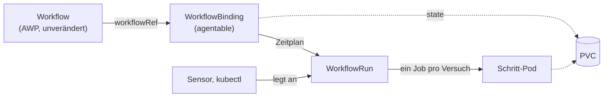
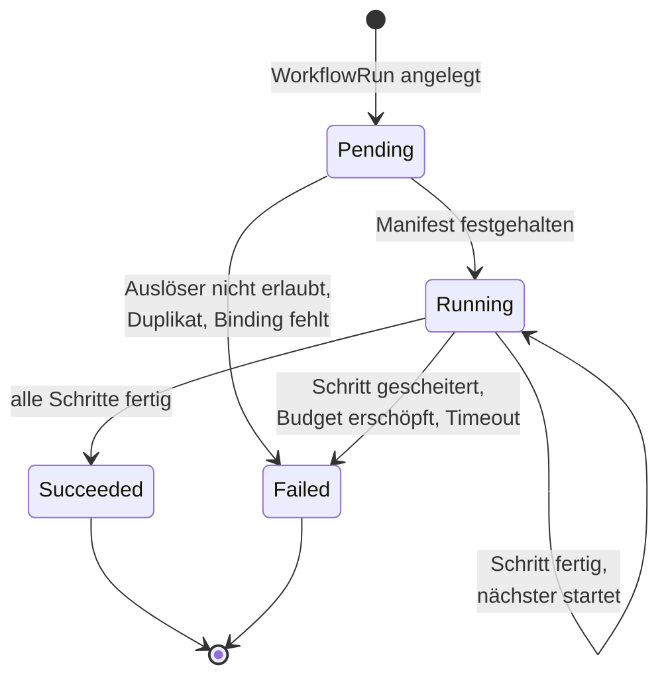
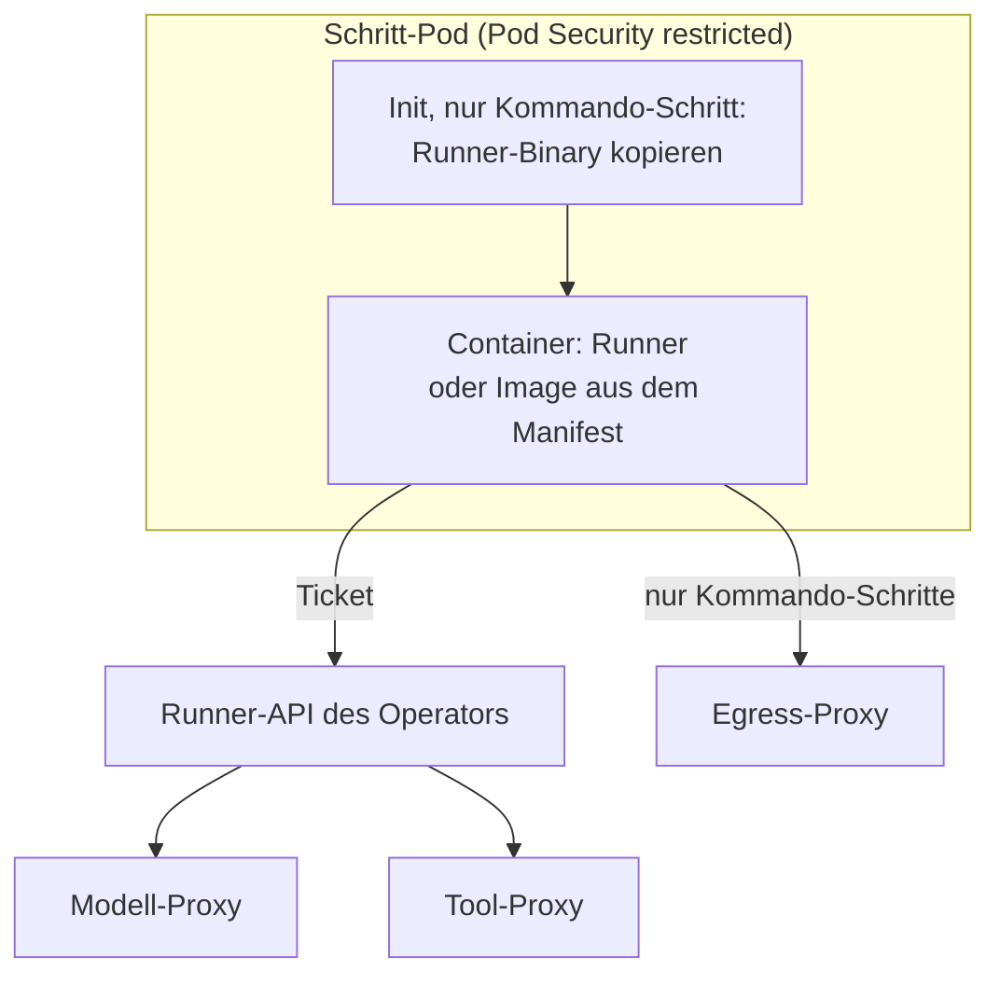

# 04 Laufzeit

Die Laufzeit führt Manifeste aus. Im PoC ist das agentable: ein Kubernetes-Operator (Go, controller-runtime) und ein Runner-Binary, das in jedem Schritt-Pod läuft.

## Ressourcen

| Ressource | API-Gruppe | Inhalt | Wer legt an |
| --- | --- | --- | --- |
| `Workflow` | `awp.agenticworkflowprotocol.org/v1alpha2` | das Manifest; der Operator schreibt nur Conditions `Valid` und `Bound` in den Status | GitOps |
| `WorkflowBinding` | `agentable.lnxlabs.de/v1alpha1` | Runner-Image, Proxy, Modell-Zugang, Secret-Zuordnung, Zustands-Volume, Aufbewahrung, `suspend` | GitOps (Chart) |
| `WorkflowRun` | `agentable.lnxlabs.de/v1alpha1` | ein Lauf: Auslöser, Eingaben, Kopie des Manifests mit Digest, Status je Schritt, Tokens, Kosten | Zeitplan, Sensor, Mensch |

Abweichung von AWP: Der Entwurf von `v1alpha2` (AEP-0019) definiert ein eigenes `WorkflowRun` und verlangt, dass Laufzeiten diese Art verwenden, wenn sie Läufe als Objekte anbieten. Dort ist ein von außen angelegter Lauf immer ein manueller Start, und der Auslöser steht nur im Status. agentable nutzt noch die eigene Art, und der Sensor setzt `spec.trigger.type: event`. Für Läufe, die ein vertrauenswürdiger Router anlegt, fehlt im Entwurf eine Rolle; das ist an die Spezifikation gemeldet ([Abgleich](awp-abgleich.md#neue-punkte-für-die-spezifikation)).

Genau eine Binding pro Workflow. Ohne Binding ist ein Workflow gültig, aber `Bound=False`, und nichts läuft.

## Lebenslauf eines Laufs

Beim Start prüft der Operator:

- **Auslöser:** Ein Lauf mit `trigger.type: event` braucht einen Ereignis-Auslöser im Manifest an dem Index in `triggers`, den der Lauf nennt, mit gleicher `source` und gleichem `eventType`, sonst `TriggerNotAllowed`. Den `filter` prüft der Operator nicht, weil er die Ereignisdaten nicht kennt. Wer Läufe anlegen darf, kann heute auch den Typ `manual` oder `schedule` wählen; eine Admission-Regel, nach der nur der Operator Zeitplan-Läufe und Sensoren nur Ereignis-Läufe anlegen, ist geplant.
- **Duplikate:** siehe [Kapitel 06](06-ereignisse.md#zustellung-und-duplikate).
- **Festhalten:** Der Lauf speichert eine Kopie des Manifests mit Digest. Ein GitOps-Sync mitten im Lauf ändert nichts mehr.

Danach startet jeder Schritt, sobald seine Abhängigkeiten erfolgreich sind, als eigener Kubernetes-Job.

## Der Schritt-Pod

- **Kein Kubernetes-Token** (`automountServiceAccountToken: false`), kein Modell-Schlüssel, nicht als root, Dateisystem nur lesbar außer `/tmp` und den Ausgaben.
- **Ein Ticket pro Versuch.** Der Runner holt mit dem Ticket seinen Auftrag (`GET /v1/assignment`), ruft Modell und Werkzeuge über den Proxy und gibt Ausgaben ab (`POST /v1/complete`). Das Ticket gilt nur für diesen einen Versuch dieses einen Schritts. Eingaben und Ausgaben stehen nie in der Pod-Spezifikation.
- **Agenten-Schritte** laufen im Runner-Image: Tool-Schleife gegen den Modell-Proxy, Abschluss über das Werkzeug `complete_step` mit den deklarierten Ausgaben.
- **Kommando-Schritte** laufen im Image aus dem Manifest. Ein Init-Container kopiert den Runner hinein; er setzt die Umgebung (Ausdrücke aus `env`, Secrets mit `scope: command`, das Zustandsverzeichnis, Proxy-Variablen), startet das Kommando und liest danach die Dateien in `$AWP_OUTPUTS`. Die Variable für das Zustandsverzeichnis heißt im PoC `AWP_STATE_DIR`; der Präfix `AWP_` ist der Spezifikation vorbehalten, sie wird umbenannt, bis AWP einen Zustand definiert (G03).

## Modell-Proxy und Tool-Proxy

Der Operator ist die einzige Tür zu Modellen und eingebauten Werkzeugen:

| Prüfung | Modell-Proxy | Tool-Proxy |
| --- | --- | --- |
| Ist der Aufruf erlaubt? | Modell und Anbieter wie im Manifest | Werkzeug in `permissions`, Host in `allowHosts` (ohne `network`-Block heute jeder Host, siehe [Kapitel 08](08-isolation-und-netzwerk.md#der-operator-als-zweite-tür)) |
| Budget | Kosten und Tokens gegen Lauf, Agent und Schritt | Zahl der Aufrufe |
| Geheimnis | setzt den Anbieter-Schlüssel ein; der Pod sieht ihn nie | |
| Zählen | Tokens, Kosten pro Schritt im Status | Aufrufe im Status |
| Protokoll | Audit-Ereignis pro Aufruf | Audit-Ereignis pro Aufruf |

Werkzeuge, die die Laufzeit nicht kennt, oder Funktionen wie Freigaben, die sie noch nicht umsetzt, führen zu `Valid=False` am Workflow: Er wird nicht halb ausgeführt.

Offen: Der Modell-Proxy reicht die Anfrage heute bis auf Modell und Schlüssel unverändert an den Anbieter weiter. Serverseitige Werkzeuge des Anbieters (Websuche, MCP) wären so ein Ausgang an beiden Proxys vorbei; der Proxy muss die erlaubten Felder einer Anfrage festlegen.

## Zustand

Eine Binding kann ein Zustands-Volume mitbringen oder ein vorhandenes nennen; Kommando-Schritte bekommen es, wenn `permissions.filesystem` es erlaubt. Details in [Kapitel 11](11-zustand-und-kontext.md).

## Ausführungsort

Wo ein Schritt läuft, entscheidet die Binding mit Kubernetes-Mitteln, nie das Manifest:

| Bedarf | Mittel | Stand |
| --- | --- | --- |
| normaler Schritt | Pod pro Versuch | umgesetzt |
| stärkere Isolation | `runtimeClassName` (gVisor, Kata) | geplant |
| bestimmte Hardware, Homelab | eigener Knoten, `nodeSelector`, `tolerations` | geplant |
| kurzlebige Maschinen, zum Beispiel für Scans | Knoten-Pool mit Autoscaler und Taint | geplant |
| echte VM | KubeVirt | offen (bei Bedarf) |
| Rechner, der kein Knoten werden kann | Pull-Modus | offen (zurückgestellt, E05) |

Damit bleiben Authentifizierung, RBAC und NetworkPolicy wie gewohnt, und die Runner-API muss nicht von außen erreichbar sein. Warum der Pull-Modus wartet, steht in den [Entscheidungen](entscheidungen.md).
