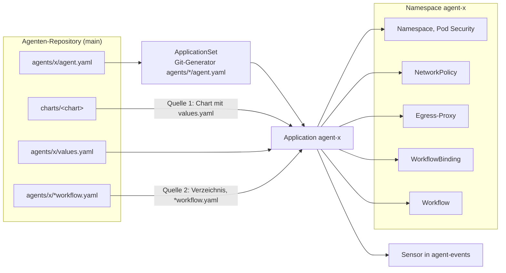

# 05 Bereitstellung mit GitOps

## Ein Verzeichnis pro Agent

Alle Agenten liegen in einem Repository. Ein neuer Agent ist ein neues Verzeichnis, ein entfernter Agent ist weg, samt Namespace.

```text
agents/
  assistent/
    agent.yaml          # welches Chart: mattermost-chat
    values.yaml         # Laufzeit und Plattform: Kanal, Benutzer, Egress
    workflow.yaml       # AWP-Manifest
  konzert-scout/
    agent.yaml          # Chart: agent
    values.yaml         # zwei Workflows, Zustand, Secrets, Ereignisse, Egress-Domains
    workflow.yaml       # täglicher Lauf
    chat.workflow.yaml  # Antworten im Chat
    tools/              # Skripte und Containerfile des Werkzeug-Images
    tests/
charts/
  agent-lib/            # Bibliothek: Namespace, NetworkPolicy, Binding, Sensor, RBAC
  agent/                # generisch, ein oder mehrere Workflows
  mattermost-chat/      # Anwendungsfall: Chat-Agent in einem Kanal
platform/               # Argo Events: EventBus, EventSource
tools/                  # generisches Runtime-Image (Antwort-Skript, Hilfsfunktionen)
argocd/                 # das ApplicationSet, das einzige Objekt im GitOps-Repository
```

## Vom Verzeichnis zum laufenden Agenten



- **ApplicationSet** mit Git-Dateien-Generator auf `agents/*/agent.yaml`. Jede Datei ergibt eine Application `agent-<verzeichnis>` mit Ziel-Namespace `agent-<verzeichnis>`.
- **Zwei Quellen pro Application:** das Chart aus `agent.yaml` mit der `values.yaml` des Agenten, und das Verzeichnis selbst mit allen Dateien `*workflow.yaml`. Das Manifest wird also nicht durch Helm geschleust, sondern unverändert angewendet; so bleibt es dieselbe Datei, die `awp-check` geprüft hat.
- **Automatischer Sync mit Prune und Self-Heal.** Was aus Git verschwindet, löscht Argo CD. Das Chart rendert den Namespace selbst (nicht `CreateNamespace`), deshalb verschwindet beim Entfernen des Verzeichnisses auch der Namespace, samt Zustand und von Hand angelegten Secrets. Ein Schutz vor versehentlichem Löschen ist offen (O13). Self-Heal heißt auch: Änderungen von Hand im Cluster setzt Argo CD in Sekunden zurück ([Kapitel 15](15-betrieb.md#einen-agenten-abschalten)).
- **Keine Abhängigkeit von OCI.** Charts liegen im selben Repository und werden über Pfade eingebunden; Abhängigkeiten zwischen Charts laufen über `file://`.

Im PoC dauert es vom Push bis zum laufenden Agenten rund 20 Sekunden (mit Refresh), das Entfernen genauso.

Das ApplicationSet läuft im Argo-CD-Projekt `agents`, das nur die Namespaces `agent-*` und nur die Objektarten der Charts erlaubt; ein Chart kann so keine beliebigen Objekte im Cluster anlegen (umgesetzt).

## Charts

| Chart | Art | Rendert |
| --- | --- | --- |
| `agent-lib` | Bibliothek | Vorlagen: Namespace mit Pod Security `restricted`, NetworkPolicy `agent-egress`, WorkflowBinding, Sensor mit ServiceAccount und RBAC |
| `agent` | generisch | ein oder mehrere Workflows (`workflows:` in den Werten), je Workflow Binding und optional Sensor; Egress-Proxy als Abhängigkeit |
| `mattermost-chat` | Anwendungsfall | Chat-Agent: berechnet Filter aus Kanal, Modus (Kanal oder Erwähnung), Bot-Name und erlaubten Benutzern; bindet den Bot-Token. Bringt einen eigenen Egress-Proxy mit dem Chat-Host als einziger Domain mit |

Die Bibliothek enthält, was für alle gleich ist; Anwendungs-Charts übersetzen fachliche Werte ("antworte in Kanal X, nur Benutzer Y") in Filter und Bindings. Wer einen neuen Typ von Agent häufiger braucht, baut ein weiteres Anwendungs-Chart auf der Bibliothek.

## Wer legt was an

| Objekt | Wer | Warum dort |
| --- | --- | --- |
| Namespace, Pod Security, NetworkPolicy, Egress-Proxy, RBAC | Argo CD über das Chart | Plattform-Grenzen, gehören dem Betreiber |
| Workflow (AWP) | Argo CD, unverändert aus dem Verzeichnis | geprüftes Manifest |
| Squid-Regeln, Egress-Modus | heute: Werte des Agenten; geplant: Obergrenze des Betreibers außerhalb des Agenten-Verzeichnisses | siehe [Kapitel 02](02-drei-ebenen.md#durchsetzung-heute) |
| WorkflowBinding, Sensor | Argo CD über das Chart | Laufzeit-Bindung |
| WorkflowRun | Zeitplan, Sensor, Mensch | ein Lauf ist kein Soll-Zustand und gehört nicht in Git |
| Schritt-Pods, Zustands-Volume | Operator | Laufzeit-Details |

## Prüfungen vor dem Merge

Die CI des Agenten-Repositorys prüft jede Änderung:

- jedes `*workflow.yaml` gegen das AWP-Schema, ohne `metadata.namespace`, Name passt zu den Werten
- jedes Chart rendert mit den Werten jedes Agenten; alle Objekte landen im richtigen Namespace
- Skripte der Agenten: Typprüfung und Unit-Tests pro Agent
- Images (Runtime und Werkzeug-Images) bauen

Geplant: `awp-check` in der CI und eine Prüfung im Cluster, damit ungültige Manifeste gar nicht erst ankommen (G09). Der AWP-Entwurf (AEP-0021) setzt dafür auf eine CRD, die unbekannte Felder verwirft, plus CEL-Regeln statt eines Webhooks. Ebenfalls geplant: eine Richtlinien-Prüfung der Werte (siehe oben) und eine Prüfung, dass Sensor-Filter nur enger sind als der `filter` im Manifest.
