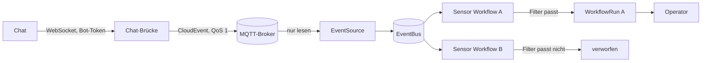

# 06 Ereignisse und Auslöser

## Drei Arten von Auslösern

| Auslöser | Wer legt den Lauf an | Beispiel | Stand |
| --- | --- | --- | --- |
| `manual` | Mensch mit `kubectl create`, später ein Chat-Befehl | Testlauf | umgesetzt |
| `schedule` | Operator (Cron mit Zeitzone, `concurrencyPolicy`, `startingDeadline`) | jeden Morgen um sieben | umgesetzt |
| `event` | Ereignis-Router (Argo Events) | Chat-Nachricht, Webhook, MQTT-Nachricht | umgesetzt (Chat über MQTT) |

## Der Weg eines Ereignisses



1. **Brücke:** hört über die WebSocket-API des Chats in allen Kanälen mit, in denen ihr Bot Mitglied ist. Sie überspringt Bots, Webhooks, Systemnachrichten und Änderungen und veröffentlicht jede Nachricht als CloudEvent auf `agentable/events/<chat>/<team>/<kanal>`. Bei Antworten in einem Thread hängt sie den bisherigen Verlauf an.
2. **Broker:** Mosquitto mit Benutzer und ACL pro Client. Nur die Brücke darf Chat-Ereignisse schreiben, der Router darf nur lesen. Das ist die Grundlage dafür, dass Abnehmer dem Feld `user` glauben.
3. **EventSource und EventBus:** Argo Events abonniert einmal und verteilt intern über einen JetStream-EventBus.
4. **Sensor pro Workflow:** filtert deterministisch (Quelle, Typ, Kanal, Absender, Erwähnung, Thread) und legt einen `WorkflowRun` an, mit `trigger.type: event`, Quelle, Typ, Ereignis-ID und den Feldern als Inputs. Ein Ereignis kann mehrere Workflows starten.
5. **Operator:** prüft, ob der Workflow diesen Auslöser erlaubt, verwirft Duplikate und führt aus.

Bis zum Agenten-Schritt ist kein Modell beteiligt.

## Format: CloudEvents

Jede Nachricht auf dem Bus ist ein CloudEvent 1.0 im strukturierten JSON-Format:

```json
{
  "specversion": "1.0",
  "id": "<post id>",
  "source": "chat.example.org",
  "type": "org.example.chat.post",
  "subject": "team/konzerte",
  "time": "2026-11-20T04:30:00Z",
  "datacontenttype": "application/json",
  "data": {
    "postId": "...", "rootId": "...", "channelId": "...", "channel": "konzerte",
    "team": "team", "userId": "...", "user": "alice",
    "message": "@scout was spielt im März?", "mentions": ["scout"],
    "thread": [{"user": "scout", "bot": true, "time": "...", "message": "..."}],
    "threadTruncated": false
  }
}
```

Warum CloudEvents, obwohl Argo Events intern ohnehin einen eigenen Rahmen baut: `id` dient der Duplikaterkennung, andere Abnehmer am Broker bekommen ein beschriebenes Format, und `source` und `type` passen direkt zu `source` und `eventType` der AWP-Auslöser.

## Filtern auf zwei Ebenen

| Ebene | Was dort steht | Beispiel |
| --- | --- | --- |
| Manifest (geprüft, im Digest) | welche Ereignisse der Workflow annimmt: `source`, `eventType`, einfacher `filter` | `filter: {data.user: alice}` |
| Sensor (Laufzeit) | wie Ereignisse ankommen und feinere Filter | Erwähnung des Bots ODER Antwort in einem Thread des Bots; Ratenbegrenzung |

Regel: Der Sensor darf nur enger filtern als das Manifest. Langfristig soll die Laufzeit den Sensor aus dem `triggers`-Block erzeugen, dann bleibt das Manifest die einzige Quelle.

## Zustellung und Duplikate

Ehrlich benannt: Die Brücke veröffentlicht mit QoS 1 (mindestens einmal), aber die MQTT-EventSource von Argo Events abonniert fest mit QoS 0. Ab dem Broker gilt also höchstens einmal; fällt die EventSource gerade aus, geht eine Nachricht verloren. Für Chat reicht das, für wichtige Ereignisse nicht (dann eigener Abonnent mit QoS 1 oder ein Webhook mit Wiederholung).

Umgekehrt können Ereignisse doppelt ankommen: zwei Routen im selben Sensor passen auf dieselbe Nachricht (Erwähnung in einem Thread), ein Neustart, eine Wiederholung. Deshalb verwirft der Operator einen zweiten Lauf mit gleicher Quelle und Ereignis-ID (Label aus dem Hash von `source/id`). Das ist Pflicht, nicht Kür; im PoC hat es genau diesen Fall zweier passender Routen abgefangen.

## Abgrenzung zu CI/CD

| | CI/CD (Tekton, GitLab CI, Forgejo Actions) | AWP | Laufzeit (agentable) |
| --- | --- | --- | --- |
| Was | Engine für feste Abläufe | Spezifikation, keine Engine | Laufzeit für AWP auf Kubernetes |
| Wer handelt | vertrauenswürdiger, fest geschriebener Code | Agenten mit nicht vorhersagbarem Verhalten, dazu Kommandos | |
| Kernfrage | läuft Build, Test, Deploy durch | was darf ein Agent: Modell, Werkzeuge, Aktionen, Budget, Freigaben, Daten, Audit | setzt das durch |

Für die Mechanik drumherum wird nichts nachgebaut: Auslöser kommen aus Argo Events (MQTT eingebaut, Sensoren mit Filtern, Trigger legen beliebige Kubernetes-Ressourcen an). Tekton Triggers hat dasselbe Modell, spricht aber nur HTTP. Ein Agenten-Schritt mit Ticket, Proxy und späteren Freigaben passt schlecht in eine CI-Task; deshalb führt die Laufzeit Schritte selbst aus.

## Webhooks und weitere Quellen

Weitere Quellen kommen nach demselben Muster: Ein Webhook-Eingang (Argo Events Webhook-EventSource) oder eine weitere Brücke wandelt in CloudEvents, ein Sensor pro Workflow filtert. Für jede Quelle gilt: Authentifiziert wird die Quelle (Signatur, Token, Broker-ACL), nicht der Inhalt.
