# 07 Kanäle und Chat

Ein vorhandener Team-Chat ist die Oberfläche: Meldungen, Rückfragen und später Freigaben. Im PoC ist das Mattermost; Slack, Matrix oder Teams gingen nach demselben Muster.

## Drei Muster

```mermaid
flowchart TB
    subgraph M1["1. Meldung"]
        A1[Lauf nach Zeitplan] --> W1[Kommando-Schritt] -->|Webhook| K1[Kanal, mit @all]
    end
    subgraph M2["2. Rückfrage zur Meldung"]
        U2[Mensch: @bot im Thread] --> E2[Ereignis] --> R2[Lauf] -->|REST, Bot-Token| T2[Antwort im Thread]
    end
    subgraph M3["3. Chat-Kanal"]
        U3[Mensch schreibt im Kanal] --> E3[Ereignis] --> R3[Lauf] -->|REST, Bot-Token| T3[Antwort im Thread]
    end
```

| Muster | Auslöser | Antwort | Beispiel | Stand |
| --- | --- | --- | --- | --- |
| Meldung | Zeitplan | eingehender Webhook in einen Kanal, mit `@all` für Push aufs Telefon | neue Konzerte, nach Monat gruppiert | umgesetzt |
| Rückfrage | Erwähnung des Bots oder Antwort in seinem Thread | im Thread, mit dem bisherigen Verlauf als Kontext | "@scout was spielt im März?" | umgesetzt |
| Chat-Kanal | jede Nachricht erlaubter Benutzer in einem Kanal | im Thread | freier Assistent ohne Werkzeuge | umgesetzt |
| Freigabe | Schritt braucht eine Entscheidung | Knöpfe "Freigeben / Ablehnen", Lauf wartet | Pull Request anlegen, Scan starten | geplant |
| Status | Chat-Befehl | direkt aus dem Kubernetes-Status, ohne Modell | `/agent status` | geplant |

## Bot-Konten

| Konto | Aufgabe | Rechte |
| --- | --- | --- |
| Brücke | hört mit, schreibt nie (Konvention: ein Bot-Token im Chat ist nie nur lesend, er wird wie ein Schreib-Token geschützt) | Mitglied nur in den Kanälen, die Ereignisse liefern sollen |
| ein Bot pro Agent | antwortet im Namen des Agenten | schreibt in seine Kanäle; Token als Secret mit `scope: command` |
| Webhook pro Meldekanal | Meldungen ohne Bot | nur dieser Kanal |

Die Brücke ist bewusst ein eigenes Konto: Sie braucht Lesezugriff auf viele Kanäle, schreibt aber nichts. Antworten kommen vom Bot des Agenten, damit im Chat sichtbar ist, wer antwortet, und damit ein Agent nicht im Namen eines anderen schreiben kann. Die Brücke überspringt Nachrichten aller Bots; ein Agent kann sich so nicht selbst auslösen.

## Formatierung

Meldungen sind für das Telefon geschrieben: kurze Zeilen, nach Monat gruppierte Listen statt breiter Tabellen, ein Link pro Eintrag. Für Push-Benachrichtigungen braucht es eine Erwähnung (`@all` im Meldekanal oder den Benutzernamen); die Push-Einstellung "nur Erwähnungen" ist der Normalfall. Formatregeln stehen in den Anweisungen des Manifests, nicht in der Laufzeit.

## Rückweg

Wie kommt die Antwort an die richtige Stelle? Das Ereignis bringt die Korrelationsdaten mit (`channelId`, `rootId`), der Sensor gibt sie als Inputs weiter, und der letzte Schritt postet mit dem Bot-Token über die REST-API in den Thread. Es gibt keinen Rückkanal über MQTT; die Zustellung ist ein normaler Kommando-Schritt mit festem Code (`reply.py` im Runtime-Image).

Diese Lösung hält das Manifest ehrlich: Es sieht, dass ein Schritt nach außen schreibt, und es braucht dafür ein Secret.

Zwei Regeln für den Antwort-Schritt (beide offen):

- **Ziel fest, nicht aus Eingaben.** Die Adresse des Chats kommt aus der Binding, nur `https://`, nicht aus einem Input; sonst könnte ein Lauf den Token an ein fremdes Ziel schicken.
- **Antwort bereinigen.** Die Antwort des Modells wird vor dem Posten bereinigt: keine Bilder (ein Bild mit Daten in der URL wird vom Client geladen), Links nur zu erlaubten Hosts, keine Massen-Erwähnungen wie `@all`.

Die Spezifikation kennt den Rückweg noch nicht als eigenes Konzept (G45); vorgeschlagen ist, nur die Korrelationsdaten im Ereignis zu standardisieren und die Zustellung den Schritten zu lassen.

## Weitere Kanäle

Nicht jede Meldung gehört in den Chat. Im PoC schickt der Konzert-Scout seine Zusammenfassung zusätzlich über ein Kontaktformular per E-Mail und optional über Telegram. Jeder Kanal ist ein eigener Kommando-Schritt, schaltbar über einen Input (leer heißt aus), mit eigenem Secret und eigener Domain im Egress-Proxy.
