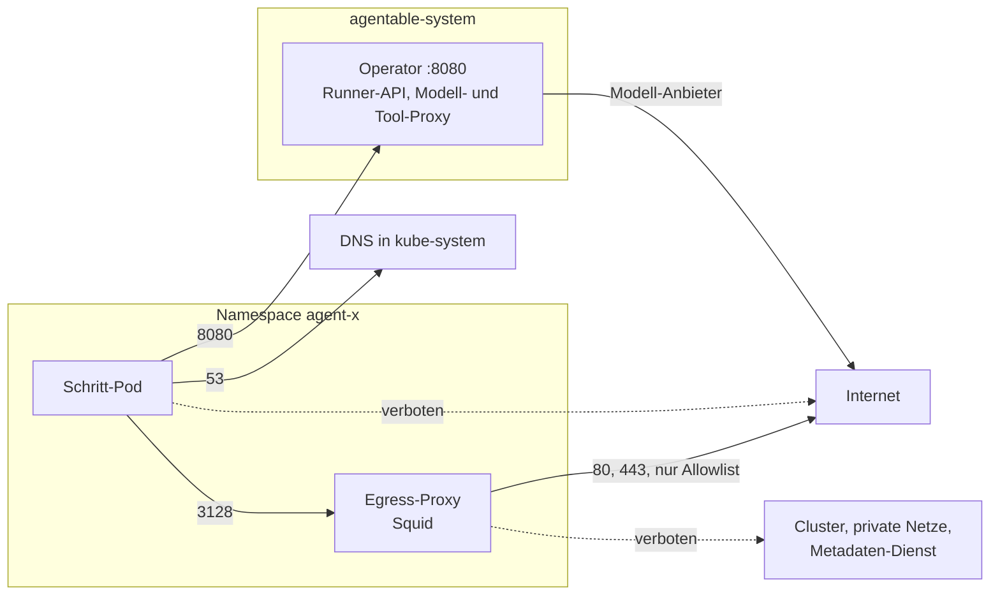

# 08 Isolation und Netzwerk

## Ein Namespace pro Agent

Jeder Agent läuft in einem eigenen Namespace `agent-<name>`. Der Namespace ist die Einheit für Isolation, Rechte, Netzwerk und Aufräumen:

- **Pod Security `restricted`** (erzwungen): kein root, keine Privilegien, keine zusätzlichen Capabilities, Seccomp `RuntimeDefault`.
- **Keine Kubernetes-Rechte** für Schritt-Pods; der Token wird nicht eingehängt.
- **Eigene Secrets** pro Agent; ein Agent kann die Secrets eines anderen nicht referenzieren.
- **Aufräumen** ist das Löschen des Namespace, wenn das Verzeichnis aus Git verschwindet.

## Netzwerk: zu, bis auf drei Türen

Die NetworkPolicy `agent-egress` gilt für alle Pods des Namespace:

| Richtung | Erlaubt |
| --- | --- |
| Eingang | nichts |
| Ausgang | DNS in `kube-system`; Operator in `agentable-system` auf 8080; je nach Modus: nichts weiter, eine Liste von CIDRs, oder der Egress-Proxy im eigenen Namespace auf 3128 |

| Modus | Bedeutung | Wann |
| --- | --- | --- |
| `none` | nur DNS und Operator | Agenten ohne Kommando-Schritte mit Außenkontakt, zum Beispiel der Chat-Assistent |
| `proxy` | zusätzlich der eigene Egress-Proxy | Standard für Agenten, die Webseiten lesen oder zustellen |
| `allowlist` | zusätzlich CIDRs und Ports | interne Dienste ohne HTTP, Übergang |

Agenten-Schritte brauchen nie mehr als den Operator: Modell und eingebaute Werkzeuge erreichen sie über den Proxy des Operators, der selbst prüft, welche Hosts erlaubt sind.

## Egress-Proxy pro Agent

NetworkPolicies kennen nur IP-Adressen, keine Hostnamen. Wer "nur `www.example.org`" erlauben will, braucht einen Proxy, der den Namen sieht. Dafür bekommt jeder Agent im Modus `proxy` einen eigenen Squid in seinem Namespace:

- **Allowlist von Domains** (`.example.org` für die Domain samt Subdomains), Ports 80 und 443, CONNECT nur auf 443. Alles andere: verboten.
- **Keine privaten Ziele:** Ziele, die auf private, Loopback-, Link-Local- (Cloud-Metadaten) oder CGNAT-Adressen auflösen, verweigert Squid, auch wenn die Domain erlaubt ist. Zusätzlich schließt die NetworkPolicy des Proxys diese Netze aus.
- **Keine Authentifizierung, kein Cache.** Die Clients sind durch Namespace und Policy bestimmt; ein Cache bringt bei wenigen Abrufen am Tag nichts und wäre ein weiterer Ort für Daten.
- **Zugriffsprotokoll auf stdout:** jede erlaubte und verweigerte Anfrage mit Ziel.
- **Gehärtet:** Image `ubuntu/squid` (Canonical, mit Sicherheitsupdates neu gebaut), nicht als root, nur lesbares Dateisystem, passt zu Pod Security `restricted`.

Die Kommando-Schritte bekommen `HTTP_PROXY`, `HTTPS_PROXY` und `NO_PROXY` über die Binding (`executor.proxy`); die Runner-API des Operators ist immer ausgenommen.

Warum ein Proxy pro Agent und nicht einer für alle: Jeder Agent hat seine eigene Allowlist und sein eigenes Protokoll, ein Fehler in einer Allowlist betrifft nur einen Agenten, und der Proxy verschwindet mit dem Agenten. Die Kosten sind klein (rund 30 MiB Speicher pro Instanz).

## HTTPS wird nicht aufgebrochen

Squid sieht bei HTTPS nur den Hostnamen aus CONNECT, nicht Pfad oder Inhalt. Das reicht für eine Allowlist von Domains, nicht für "nur dieser Pfad". TLS aufzubrechen hieße, dem Proxy eine eigene CA zu geben und jedem Image zu vertrauen beizubringen; der Gewinn steht im PoC nicht im Verhältnis. Wer es braucht, setzt es pro Agent ein.

## Durchsetzung

NetworkPolicies wirken nur mit einer CNI, die sie durchsetzt. k3s bringt das mit; Docker Desktop nicht. Im lokalen PoC sind die Policies deshalb vorhanden, aber nicht wirksam; der Squid selbst filtert trotzdem. Wer FQDN-Policies der CNI (Cilium, Calico Enterprise) hat, kann den Proxy für reine Hostnamen-Regeln ersetzen, verliert aber das Zugriffsprotokoll pro Agent.

## Woher die Allowlist kommt

Heute pflegt man die Domains in der `values.yaml` des Agenten. Das Manifest kennt dafür `permissions.network.allowHosts`. Ziel ist, dass die Allowlist des Proxys aus dem Manifest abgeleitet und mit einer Obergrenze des Betreibers geschnitten wird ([Kapitel 02](02-drei-ebenen.md#doppelte-angaben-sind-gewollt), G47).
