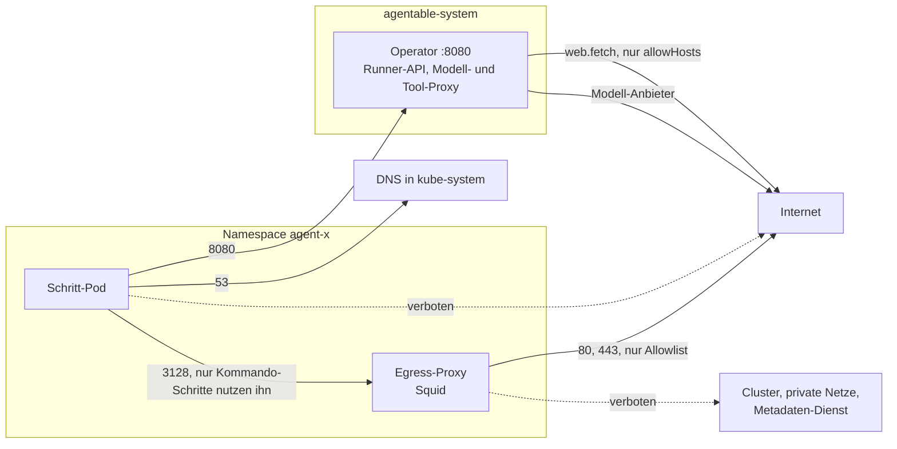

# 08 Isolation und Netzwerk

## Ein Namespace pro Agent

Jeder Agent läuft in einem eigenen Namespace `agent-<name>`. Der Namespace ist die Einheit für Isolation, Rechte, Netzwerk und Aufräumen:

- **Pod Security `restricted`** (erzwungen, umgesetzt): kein root, keine Privilegien, keine zusätzlichen Capabilities, Seccomp `RuntimeDefault`.
- **Keine Kubernetes-Rechte** für Schritt-Pods; der Token wird nicht eingehängt (umgesetzt).
- **Eigene Secrets** pro Agent; ein Agent kann die Secrets eines anderen nicht referenzieren (umgesetzt).
- **Aufräumen** ist das Löschen des Namespace, wenn das Verzeichnis aus Git verschwindet (umgesetzt; Schutz des Zustands vor versehentlichem Löschen: offen, O13).

## Netzwerk: zu, bis auf wenige Türen

Die NetworkPolicy `agent-egress` gilt für alle Pods des Namespace:

| Richtung | Erlaubt | Stand |
| --- | --- | --- |
| Eingang | nichts | umgesetzt |
| Ausgang | DNS in `kube-system`; Runner-API des Operators auf 8080; je nach Modus nichts weiter, eine Liste von CIDRs, oder der Egress-Proxy im eigenen Namespace auf 3128 | umgesetzt (Chart), wirksam erst mit einer CNI, die Policies durchsetzt |

| Modus | Bedeutung | Wann |
| --- | --- | --- |
| `none` | nur DNS und Operator | Agenten ganz ohne Außenkontakt, auch ohne Zustellung |
| `proxy` | zusätzlich der eigene Egress-Proxy | Standard, auch für Chat-Agenten (der Chat-Host ist dann die einzige Domain) |
| `allowlist` | zusätzlich CIDRs und Ports | interne Dienste ohne HTTP, Übergang |

Drei Einschränkungen, ehrlich benannt:

- **Die Policy kennt keine Schrittarten.** Auch Agenten-Pods könnten den Squid erreichen; dass sie es nicht tun, sichert heute der Runner, der für Agenten-Schritte keine Proxy-Variablen setzt. Geplant: Pod-Selektor nach Schrittart.
- **DNS ist offen.** Alle Pods dürfen DNS fragen, und DNS kann Daten tragen (Tunnel). Geplant: Agenten-Namespaces lösen nur Cluster-Namen auf, der Squid löst externe Namen selbst auf.
- **Der Port 8080 in `agentable-system`** sollte nur den Operator meinen. Im PoC erlaubt die Policy den ganzen Namespace auf 8080 (dort lauscht auch die Brücke). Geplant: Auswahl der Operator-Pods per Label.

## Der Operator als zweite Tür

Agenten-Schritte erreichen nur den Operator. Dessen Tool-Proxy ruft aber eingebaute Werkzeuge wie `web.fetch` aus dem Operator heraus auf; das ist eine eigene Tür ins Internet, am Egress-Proxy des Agenten vorbei. Für sie müssen dieselben Regeln gelten wie für den Squid:

| Regel | Stand |
| --- | --- |
| nur Hosts aus `allowHosts` des Manifests; ohne `allowHosts` kein Abruf | umgesetzt |
| private, Loopback-, Link-Local- und CGNAT-Ziele nach der Namensauflösung verweigern, auch bei Weiterleitungen | umgesetzt (Schalter für Tests, standardmäßig aus) |
| eigene NetworkPolicy für den Operator | offen |
| Protokoll pro Lauf mit Ziel | teilweise (Audit-Ereignis pro Aufruf) |

Langfristig gehört der Abruf fremder Inhalte nicht in die am stärksten berechtigte Komponente: Der Operator liest Secrets, hält Modell-Schlüssel und verarbeitet fremdes HTML. Geplant ist ein eigener Abruf-Dienst ohne Rechte, oder der Abruf über den Squid des Agenten.

## Egress-Proxy pro Agent

NetworkPolicies kennen nur IP-Adressen, keine Hostnamen. Wer "nur `www.example.org`" erlauben will, braucht einen Proxy, der den Namen sieht. Dafür bekommt jeder Agent im Modus `proxy` einen eigenen Squid in seinem Namespace (umgesetzt, im PoC für beide Agenten):

- **Allowlist von Domains**, Ports 80 und 443, CONNECT nur auf 443. Alles andere: verboten. Die Schreibweise `.example.org` (Domain samt Subdomains) ist Squid-Syntax; AWP legt für `allowHosts` noch keine Syntax fest.
- **Keine privaten Ziele:** Ziele, die auf private, Loopback-, Link-Local- (Cloud-Metadaten) oder CGNAT-Adressen auflösen, verweigert Squid, auch wenn die Domain erlaubt ist. Zusätzlich schließt die NetworkPolicy des Proxys diese Netze aus.
- **Keine Authentifizierung, kein Cache.** Die Clients sind durch Namespace und Policy bestimmt; ein Cache bringt bei wenigen Abrufen am Tag nichts und wäre ein weiterer Ort für Daten.
- **Zugriffsprotokoll auf stdout:** jede erlaubte und verweigerte Anfrage mit Ziel.
- **Gehärtet:** Image `ubuntu/squid` (Canonical, mit Sicherheitsupdates neu gebaut), nicht als root, nur lesbares Dateisystem, passt zu Pod Security `restricted`.

Geplante Härtung: Domains ohne Rückwärtsauflösung vergleichen (`dstdomain -n`) und CONNECT auf IP-Adressen verweigern; breite Einträge (ganze Stadt- oder CDN-Domains) vermeiden, weil hinter ihnen viele fremde Inhalte liegen.

Die Kommando-Schritte bekommen `HTTP_PROXY`, `HTTPS_PROXY` und `NO_PROXY` über die Binding (`executor.proxy`, umgesetzt); die Runner-API des Operators ist immer ausgenommen. Das wirkt nur für Programme, die diese Variablen beachten, und ein Manifest kann sie über `env` überschreiben. Die Sperre gegen direkten Verkehr ist deshalb die NetworkPolicy, nicht die Variable. Geplant: Proxy-Variablen in `env` bei der Prüfung des Manifests ablehnen.

Warum ein Proxy pro Agent und nicht einer für alle: Jeder Agent hat seine eigene Allowlist und sein eigenes Protokoll, ein Fehler in einer Allowlist betrifft nur einen Agenten, und der Proxy verschwindet mit dem Agenten. Die Kosten sind klein (rund 30 MiB Speicher pro Instanz).

## HTTPS wird nicht aufgebrochen

Squid sieht bei HTTPS nur den Hostnamen aus CONNECT, nicht Pfad oder Inhalt. Das reicht für eine Allowlist von Domains, nicht für "nur dieser Pfad", und es schützt nicht vor Domain-Fronting über ein CDN. TLS aufzubrechen hieße, dem Proxy eine eigene CA zu geben und jedem Image zu vertrauen beizubringen; der Gewinn steht im PoC nicht im Verhältnis. Wer es braucht, setzt es pro Agent ein.

## Durchsetzung

NetworkPolicies wirken nur mit einer CNI, die sie durchsetzt. k3s bringt das mit, Docker Desktop nicht. Im lokalen PoC sind die Policies vorhanden, aber nicht wirksam. Wer FQDN-Policies der CNI hat (Cilium, Calico Enterprise), kann den Proxy für reine Hostnamen-Regeln ersetzen, verliert aber das Zugriffsprotokoll pro Agent.

## Woher die Allowlist kommt

Heute stehen Modus und Domains in der `values.yaml` des Agenten, also im selben Pull Request wie das Manifest. Was die Werte darüber hinaus nicht dürfen, prüft die CI ([Kapitel 02](02-drei-ebenen.md#durchsetzung-heute)).

Ziel: Das Manifest nennt seine Ziele in `permissions.network` (`egress: deny`, `allowHosts`), die Laufzeit leitet daraus die Allowlist des Squids ab und schneidet sie mit einer Obergrenze des Betreibers. Ist die Obergrenze enger als das Manifest verlangt, wird der Workflow abgelehnt, statt still beschnitten zu laufen (G47, O02).
