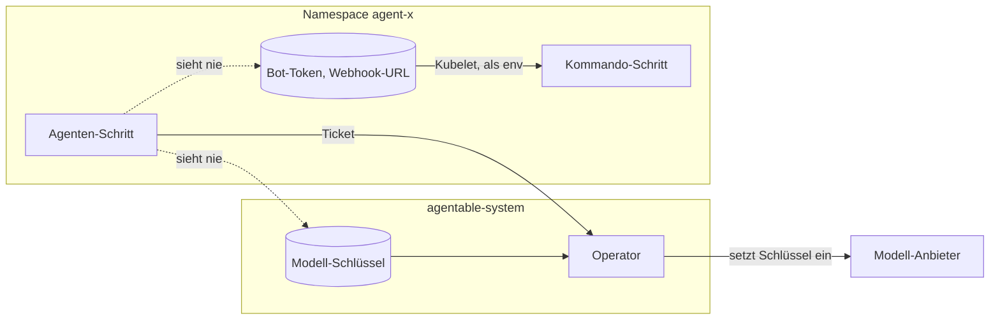

# 09 Secrets und Identitäten

## Wer welches Geheimnis sieht



| Geheimnis | Liegt in | Sieht es | Sieht es nicht |
| --- | --- | --- | --- |
| Modell-Schlüssel | im PoC: Secret im Namespace jedes Agenten, von der Binding referenziert; geplant: nur im Namespace des Operators | der Operator (Modell-Proxy) | Schritt-Pods, solange keine Binding das Secret einem Kommando-Schritt zuordnet (heute nur Konvention) |
| Bot-Token, Webhook-URL, Formular-Zugang | Secret im Namespace des Agenten | Kommando-Schritte mit passendem `scope` | Agenten-Schritte, andere Agenten |
| Ticket | Secret pro Versuch, vom Operator erzeugt | genau dieser Schritt-Versuch | alle anderen |
| Broker-Zugang | Secret der Brücke und des Routers | Brücke (schreiben), Argo Events (lesen) | Agenten |
| Deploy-Key für das Agenten-Repository | Secret in Argo CD | Argo CD, nur lesend | alle anderen |

Grundsatz: **Das Modell bekommt nie ein Geheimnis.** Ein Agenten-Schritt formuliert, ein Kommando-Schritt mit festem Code nutzt den Token. Selbst eine erfolgreiche Prompt-Injection kann den Token nicht ausgeben, weil er im Prozess des Agenten nicht existiert.

## Kurzlebige Zugänge statt Schlüssel

Ein Schritt-Pod bekommt nie den Schlüssel des Modell-Anbieters, sondern ein Ticket (umgesetzt):

| Eigenschaft | Umsetzung |
| --- | --- |
| gebunden an genau einen Versuch | Namespace, Lauf, Schritt und Versuchsnummer im Ticket, vom Operator signiert |
| läuft von selbst ab | Ablaufzeit gleich Schritt-Timeout plus kurzer Puffer |
| wird mit dem Schritt ungültig | der Operator prüft bei jedem Aufruf, ob genau dieser Versuch noch läuft; danach weist er das Ticket ab |
| erlaubt nur, was das Manifest erlaubt | Modell, Werkzeuge und Budget des Schritts; jeder Aufruf im Audit |

Wer einen laufenden Pod übernimmt, kann also höchstens das tun, was der Schritt ohnehin darf, und nur bis der Schritt endet. Offen sind zwei Verbesserungen: Das Ticket ist ein Bearer-Token, das ein Kommando im selben Pod lesen kann (Bindung an die Pod-Adresse nach dem ersten Abruf), und der echte Schlüssel liegt im PoC noch im Namespace jedes Agenten statt nur beim Operator (siehe Tabelle oben).

**Ausbaustufe: externes Modell-Gateway.** Ein Gateway wie LiteLLM oder Envoy AI Gateway kann pro Lauf einen virtuellen Schlüssel mit eigenem Budget ausstellen und am Ende des Laufs widerrufen; der Operator hält dann nur noch das Recht, solche Schlüssel anzulegen, nicht den Hauptschlüssel. Das lohnt sich, sobald mehrere Teams eigene Budgets und Kostenzuordnung brauchen, mehrere Anbieter dazukommen oder der Operator den Hauptschlüssel nicht halten soll. Bis dahin ist der Modell-Proxy des Operators dieses Gateway (geplant als Option).

## Deklaration und Zuordnung

Das Manifest deklariert, welche Secrets es gibt und wer sie bekommt. `scope` nennt Verbraucher: `command` für Kommando-Schritte, eine Agenten-ID oder einen MCP-Server:

```yaml
secrets:
  - {name: CHAT_BOT_TOKEN, source: kubernetes, scope: [command]}
```

Die Binding ordnet zu, welches Kubernetes-Secret dahintersteht:

```yaml
secrets:
  - {name: CHAT_BOT_TOKEN, secretRef: {name: chat-bot, key: token}}
```

Der Kubelet gibt den Wert als Umgebungsvariable in den Container; der Operator liest den Wert nie. Fehlt die Zuordnung, scheitert der Schritt sofort, statt ohne Token zu laufen.

Schwäche heute: `scope: [command]` gibt den Token **allen** Kommando-Schritten des Workflows, auch denen, die ihn nicht brauchen. Vorschlag an die Spezifikation: Schritt-IDs als `scope` (G05). Auch `source: kubernetes` im Manifest bindet es an eine Laufzeit (G26).

## Wie Secrets in den Cluster kommen

Secrets stehen nie im Agenten-Repository. Im PoC werden sie von Hand angelegt; für den Betrieb vorgesehen ist ein Secret-Operator (External Secrets oder Sealed Secrets, beide im GitOps-Repository des Betreibers vorhanden), der Secrets aus einem Tresor in den Namespace des Agenten schreibt. Dann steht in Git nur, welches Secret aus welchem Tresor-Pfad kommt.

## Identitäten

| Identität | Woran erkennbar | Wofür |
| --- | --- | --- |
| Mensch im Chat | Benutzer-ID und Name, bezeugt von der Brücke | Filter im Manifest (`data.user`), Auslöser eines Laufs |
| Brücke | Broker-Benutzer mit Schreibrecht nur auf ihr Topic | Vertrauen in die Felder des Ereignisses |
| Router (Sensor) | ServiceAccount pro Sensor mit Recht, nur `WorkflowRun` im Namespace des Agenten anzulegen | Läufe anlegen |
| Schritt-Versuch | Ticket | Auftrag holen, Proxy nutzen, Ausgaben abgeben |
| Agent nach außen | eigenes Bot-Konto | sichtbar, wer antwortet |

Der Mensch ist nicht direkt authentifiziert, sondern von der Brücke bezeugt: Authentifiziert ist die Brücke (am Chat und am Broker), sie bestätigt "diese Nachricht kam von alice". Nach dem AWP-Entwurf haben Läufe aus Ereignissen den Akteur `system` (5.2); der Akteur "wer anlegt" gilt nur für manuelle Läufe von Clients (10.8). Der bezeugte Mensch hat dort noch keinen Platz; bis das geklärt ist (G44), steht er nur in den Daten des Laufs.

Der ServiceAccount eines Sensors darf nur `WorkflowRun` in genau einem Namespace anlegen. Ein manipulierter Sensor kann aber Läufe dieses Agenten mit beliebigen Eingaben und beliebigem Auslöser-Typ anlegen; begrenzt wird das erst mit der geplanten Admission-Regel ([Kapitel 04](04-laufzeit.md#lebenslauf-eines-laufs)). Weil alle Sensoren im gemeinsamen Namespace `agent-events` liegen und ihre ServiceAccounts nach dem Workflow heißen, kollidieren gleichnamige Workflows zweier Agenten; der Name bekommt deshalb den Agenten als Präfix (offen).
