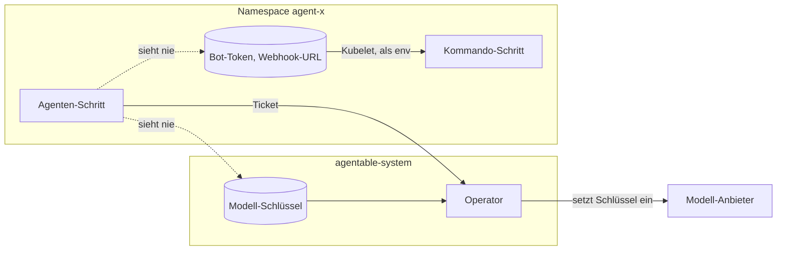

# 09 Secrets und Identitäten

## Wer welches Geheimnis sieht



| Geheimnis | Liegt in | Sieht es | Sieht es nicht |
| --- | --- | --- | --- |
| Modell-Schlüssel | Secret, von der Binding referenziert | nur der Operator (Modell-Proxy) | jeder Schritt-Pod |
| Bot-Token, Webhook-URL, Formular-Zugang | Secret im Namespace des Agenten | Kommando-Schritte mit passendem `scope` | Agenten-Schritte, andere Agenten |
| Ticket | Secret pro Versuch, vom Operator erzeugt | genau dieser Schritt-Versuch | alle anderen |
| Broker-Zugang | Secret der Brücke und des Routers | Brücke (schreiben), Argo Events (lesen) | Agenten |
| Deploy-Key für das Agenten-Repository | Secret in Argo CD | Argo CD, nur lesend | alle anderen |

Grundsatz: **Das Modell bekommt nie ein Geheimnis.** Ein Agenten-Schritt formuliert, ein Kommando-Schritt mit festem Code nutzt den Token. Selbst eine erfolgreiche Prompt-Injection kann den Token nicht ausgeben, weil er im Prozess des Agenten nicht existiert.

## Deklaration und Zuordnung

Das Manifest deklariert, welche Secrets es gibt und welche Schrittart sie bekommt:

```yaml
secrets:
  - {name: CHAT_BOT_TOKEN, source: kubernetes, scope: [command]}
```

Die Binding ordnet zu, welches Kubernetes-Secret dahintersteht:

```yaml
secrets:
  - {name: CHAT_BOT_TOKEN, secretRef: {name: chat-bot, key: token}}
```

Der Kubelet gibt den Wert als Umgebungsvariable in den Container; der Operator liest den Wert nie. Fehlt die Zuordnung, scheitert der Schritt sofort, statt ohne Token zu laufen.

Schwäche heute: `scope: [command]` gibt den Token **allen** Kommando-Schritten des Workflows, auch denen, die ihn nicht brauchen. Vorschlag an die Spezifikation: Schritt-IDs als `scope` (G05). Auch `source: kubernetes` im Manifest bindet es an eine Laufzeit (G26).

## Wie Secrets in den Cluster kommen

Secrets stehen nie im Agenten-Repository. Im PoC werden sie von Hand angelegt; für den Betrieb vorgesehen ist ein Secret-Operator (External Secrets oder Sealed Secrets, beide im GitOps-Repository des Betreibers vorhanden), der Secrets aus einem Tresor in den Namespace des Agenten schreibt. Dann steht in Git nur, welches Secret aus welchem Tresor-Pfad kommt.

## Identitäten

| Identität | Woran erkennbar | Wofür |
| --- | --- | --- |
| Mensch im Chat | Benutzer-ID und Name, bezeugt von der Brücke | Filter im Manifest (`data.user`), Auslöser eines Laufs |
| Brücke | Broker-Benutzer mit Schreibrecht nur auf ihr Topic | Vertrauen in die Felder des Ereignisses |
| Router (Sensor) | ServiceAccount pro Sensor mit Recht, nur `WorkflowRun` im Namespace des Agenten anzulegen | Läufe anlegen |
| Schritt-Versuch | Ticket | Auftrag holen, Proxy nutzen, Ausgaben abgeben |
| Agent nach außen | eigenes Bot-Konto | sichtbar, wer antwortet |

Der Mensch ist nicht direkt authentifiziert, sondern von der Brücke bezeugt: Authentifiziert ist die Brücke (am Chat und am Broker), sie bestätigt "diese Nachricht kam von alice". Ein Lauf sollte beides festhalten, wer ihn ausgelöst hat und wer das bezeugt (G44).

Der ServiceAccount eines Sensors darf nur `WorkflowRun` in genau einem Namespace anlegen. Ein manipulierter Sensor könnte also höchstens Läufe eines Agenten starten, die der Operator ohnehin gegen das Manifest prüft.
