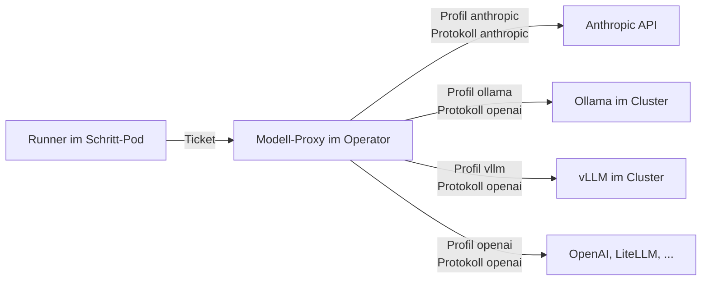

# 10 Modelle, Budgets und Kosten

## Modell nach Aufgabe

| Aufgabe | Modellklasse | Beispiel im PoC |
| --- | --- | --- |
| Daten aus Webseiten ziehen, sortieren | klein und schnell | Sammler mit `claude-haiku-5-5` |
| Bewerten, auswählen, formulieren | mittel | Kurator, Chat-Assistent mit `claude-sonnet-5-5` |
| Fehleranalyse, Code ändern | groß | geplant für Repository-Pflege |
| Filtern, Routen, Zustellen | kein Modell | Sensor, Kommando-Schritte |

Das Modell steht im Manifest pro Agent. Der Modell-Proxy lässt nur Anbieter und Modelle zu, die dort stehen.

## Anbieter-Profile

Welche Anbieter es gibt, legt der Betreiber im Operator fest, nicht das Manifest und nicht die Binding (umgesetzt). Ein Profil hat einen Namen, ein Protokoll, eine Basis-URL, optional einen Schlüssel im Namespace des Operators, Preise und eine Obergrenze für die Ausgabe-Tokens. Der Name ist der Anbieter im Manifest: `model: {provider: ollama, name: qwen3:1.7b}` geht an das Profil `ollama`. Gibt es kein Profil, ist der Workflow ungültig.



| Protokoll | Schnittstelle | Für |
| --- | --- | --- |
| `anthropic` | Messages API | Anthropic |
| `openai` | Chat Completions | OpenAI, Ollama, vLLM, llama.cpp, LiteLLM |

Der Runner spricht beide Protokolle, der Proxy prüft für jedes eine eigene Liste erlaubter Felder und zählt die Tokens aus der jeweiligen Antwort, damit Budgets bei jedem Anbieter gleich greifen. Lokale Modelle bekommen den Preis 0. Im PoC liefen Ollama (Qwen3 1.7B) und vLLM (Qwen3 0.6B) auf CPU im Cluster für kleine Tests; vLLM braucht für Werkzeuge die Startoptionen `--enable-auto-tool-choice --tool-call-parser hermes` und eine Obergrenze der Ausgabe-Tokens unter seiner Kontextlänge. Modelle unter etwa 2B Parametern taugen nur, um die Kette zu prüfen: Das 0.6B-Modell rief das Abschluss-Werkzeug mehrfach ohne Inhalt auf oder gab die Feldbeschreibung statt einer Antwort zurück.

## Budgets

Budgets sind verschachtelt: Workflow, Agent, Schritt. Jede Ebene kann Kosten, Tokens, Werkzeugaufrufe, Schritte, Dauer und Wiederholungen begrenzen.

```yaml
budget: {maxCostUsd: 0.50, maxDuration: 15m}      # ganzer Lauf
agents:
  - id: collector
    budget: {maxCostUsd: 0.05}
  - id: curator
    budget: {maxCostUsd: 0.30}
workflow:
  - id: curate
    agent: curator
    budget: {resources: {maxTokens: 100000}}
```

Der Modell-Proxy zählt nach jedem Aufruf. Ein erlaubter Aufruf darf eine Grenze überschreiten, danach wird nichts mehr erlaubt und der Lauf endet mit Fehler; nachfolgende Schritte werden übersprungen. Im PoC getestet: Mit `maxCostUsd: 0.01` stoppt der Lauf im Kurator, Zustellung und Merken entfallen.

Heute gibt es Grenzen nur pro Lauf. Für Ereignis-Läufe begrenzt sonst nur die Ratenbegrenzung des Sensors: 10 Läufe pro Minute zu 0,10 USD sind bis zu 1440 USD am Tag, ausgelöst von einem einzigen erlaubten Benutzer oder einer Schleife. Deshalb sind vor dem Produktivbetrieb Pflicht (geplant): eine **Tages- und Monatsgrenze** pro Agent und über alle Agenten (ist sie erreicht, nimmt die Laufzeit keine neuen Läufe an und meldet das), und eine **Parallelitätsgrenze** pro Workflow für Ereignis-Läufe.

## Was es kostet

Gemessene Werte aus dem PoC (Stand 20.11.2026):

| Lauf | Kosten | Woraus |
| --- | --- | --- |
| Konzert-Scout, täglicher Lauf | 0,05 bis 0,28 USD | fast nur Eingabe-Tokens des Kurators (ganze Konzert-Historie als Profil) |
| Konzert-Scout, Rückfrage im Chat | rund 0,08 USD | Profil, gespeicherte Konzerte, Thread |
| Chat-Assistent, eine Antwort | unter 0,01 bis 0,02 USD | Verlauf plus Nachricht |
| Filter, Routing, 1000 Ereignisse | 0 USD | kein Modell |

Daraus folgen drei Regeln:

1. **Teure Schritte nur, wenn nötig.** Der Kurator läuft heute auch, wenn nichts Neues da ist. Bedingte Schritte fehlen in der Spezifikation (G04); das kostet rund 1,50 USD im Monat für Läufe, die nichts melden.
2. **Kontext ist der Kostentreiber.** Ein Profil von 50 KB in jedem Lauf kostet mehr als jede Antwort. Profile kürzen, zusammenfassen oder als Werkzeug abrufbar machen.
3. **Kein Modell für Status.** Fragen wie "Läuft alles?" beantwortet die Laufzeit aus dem Kubernetes-Status, ohne Modell ([Kapitel 12](12-beobachtung.md)).

## Ratenlimits und Ausfälle des Anbieters

Modell-Anbieter begrenzen Anfragen pro Minute und Tokens pro Minute pro Schlüssel. Ein Schlüssel für alle Agenten heißt: Ein gesprächiger Agent bremst alle anderen. Geplant: Wiederholung mit Backoff bei HTTP 429 und 529 im Modell-Proxy (heute scheitert der Schritt), ein Schlüssel oder Arbeitsbereich pro Agent oder Team für getrennte Limits und Kostenzuordnung, und eine Meldung, wenn der Anbieter länger nicht erreichbar ist.

## Fixkosten der Plattform

Neben den Modellkosten kostet die Plattform selbst Rechenleistung. Grobe Schätzung für die Planung, nicht gemessen:

| Teil | Anzahl | Speicher, ungefähr |
| --- | --- | --- |
| Operator | 1 (Hochverfügbarkeit offen) | 128 MiB |
| Argo Events: Controller, EventSource, EventBus (JetStream) | 1 bis 3 | 256 MiB bis 1 GiB, je nach Replikas des EventBus |
| Sensor | einer pro Workflow mit Ereignissen | je rund 50 MiB |
| Egress-Proxy | einer pro Agent im Modus `proxy` | je rund 30 MiB |
| Schritt-Pod | einer pro laufendem Schritt, nur während des Laufs | 64 bis 256 MiB |
| Argo CD, Broker, Chat | gemeinsam mit anderen Diensten | |

Ein Agenten-Cluster für einige Dutzend Agenten passt auf zwei bis drei kleine Knoten. Jeder Schritt startet einen Pod; das kostet einige Sekunden pro Schritt, bei Chat-Antworten mit drei Schritten also rund zehn Sekunden bis zur Antwort, bevor das Modell überhaupt rechnet.

## Preise

Die Laufzeit rechnet Tokens mit einer Preistabelle in Kosten um. Preise ändern sich; die Tabelle muss konfigurierbar sein, und unbekannte Preise dürfen ein Budget nicht aushebeln: Fehlt der Preis eines Modells und gilt eine Kostengrenze, wird der Aufruf abgelehnt (G35).
