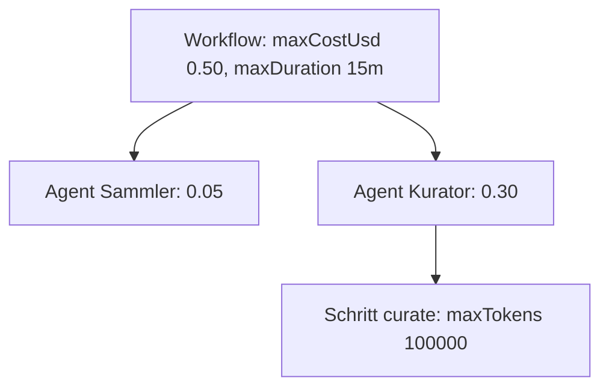

# 10 Modelle, Budgets und Kosten

## Modell nach Aufgabe

| Aufgabe | Modellklasse | Beispiel im PoC |
| --- | --- | --- |
| Daten aus Webseiten ziehen, sortieren | klein und schnell | Sammler mit `claude-haiku-5-5` |
| Bewerten, auswählen, formulieren | mittel | Kurator, Chat-Assistent mit `claude-sonnet-5-5` |
| Fehleranalyse, Code ändern | groß | geplant für Repository-Pflege |
| Filtern, Routen, Zustellen | kein Modell | Sensor, Kommando-Schritte |

Das Modell steht im Manifest pro Agent. Der Modell-Proxy lässt nur Anbieter und Modelle zu, die dort stehen.

## Budgets

Budgets sind verschachtelt: Workflow, Agent, Schritt. Jede Ebene kann Kosten, Tokens, Werkzeugaufrufe, Schritte, Dauer und Wiederholungen begrenzen.

Der Modell-Proxy zählt nach jedem Aufruf. Ein erlaubter Aufruf darf eine Grenze überschreiten, danach wird nichts mehr erlaubt und der Lauf endet mit Fehler; nachfolgende Schritte werden übersprungen. Im PoC getestet: Mit `maxCostUsd: 0.01` stoppt der Lauf im Kurator, Zustellung und Merken entfallen.

Geplant ist eine **Monatsgrenze über alle Agenten**: Ist sie erreicht, pausieren alle Zeitpläne und es kommt eine Meldung. Heute gibt es Grenzen nur pro Lauf.

## Was es kostet

Gemessene Werte aus dem PoC (Stand 20.11.2026):

| Lauf | Kosten | Woraus |
| --- | --- | --- |
| Konzert-Scout, täglicher Lauf | 0,05 bis 0,28 USD | fast nur Eingabe-Tokens des Kurators (ganze Konzert-Historie als Profil) |
| Konzert-Scout, Rückfrage im Chat | rund 0,08 USD | Profil, gespeicherte Konzerte, Thread |
| Chat-Assistent, eine Antwort | unter 0,01 bis 0,02 USD | Verlauf plus Nachricht |
| Filter, Routing, 1000 Ereignisse | 0 USD | kein Modell |

Daraus folgen drei Regeln:

1. **Teure Schritte nur, wenn nötig.** Der Kurator läuft heute auch, wenn nichts Neues da ist. Bedingte Schritte fehlen in der Spezifikation (G04); das kostet rund 1,50 USD im Monat für Läufe, die nichts melden.
2. **Kontext ist der Kostentreiber.** Ein Profil von 50 KB in jedem Lauf kostet mehr als jede Antwort. Profile kürzen, zusammenfassen oder als Werkzeug abrufbar machen.
3. **Kein Modell für Status.** Fragen wie "Läuft alles?" beantwortet die Laufzeit aus dem Kubernetes-Status, ohne Modell ([Kapitel 12](12-beobachtung.md)).

## Preise

Die Laufzeit rechnet Tokens mit einer Preistabelle in Kosten um. Preise ändern sich; die Tabelle muss konfigurierbar sein, und unbekannte Preise dürfen ein Budget nicht aushebeln: Fehlt der Preis eines Modells und gilt eine Kostengrenze, wird der Aufruf abgelehnt (G35).
