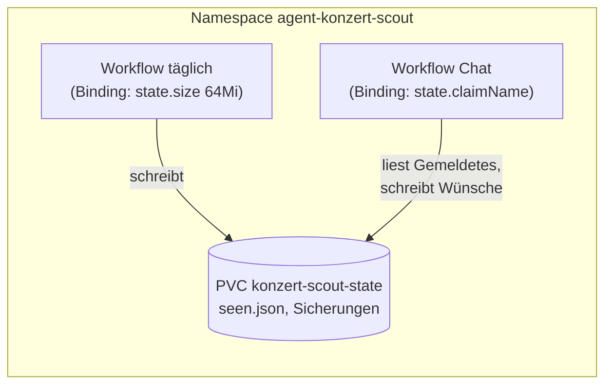

# 11 Zustand und Kontext

Ein Agent ohne Gedächtnis meldet jeden Tag dieselben Konzerte. Zwei Arten von Erinnerung sind zu unterscheiden:

| Art | Wofür | Wo | Stand |
| --- | --- | --- | --- |
| Zustand zwischen Läufen | "schon gemeldet", Vorlieben, letzte Prüfung | Zustands-Volume des Agenten | umgesetzt |
| Gesprächs-Kontext | Rückfragen im Thread verstehen | im Ereignis (Verlauf des Threads) | umgesetzt |

## Zustands-Volume

- Die Binding legt ein Volume an (`state.size`) oder nennt ein vorhandenes (`state.claimName`).
- Kommando-Schritte bekommen es unter `/awp/state`, wenn `permissions.filesystem.write` den Pfad erlaubt; Agenten-Schritte nie direkt.
- Zwei Workflows eines Agenten können denselben Zustand teilen: Der Chat-Workflow des Konzert-Scouts liest, was der tägliche Lauf gespeichert hat, und kann so beantworten, welche Konzerte schon gemeldet wurden. Er schreibt außerdem Wünsche aus dem Gespräch in eine Vorlieben-Datei, die der Kurator am nächsten Morgen liest.
- Das Skript, das den Zustand schreibt, legt vorher eine Sicherung an; das Volume ist Teil der Datensicherung des Clusters.

Das Schreiben von Wünschen ist bequem und gefährlich: Was im Chat steht, landet über das Modell im Gedächtnis und steuert den nächsten Lauf, auch wenn es aus einem Thread-Beitrag eines Dritten oder einer kopierten Webseite stammt. Zustand gilt deshalb als nicht vertrauenswürdige Eingabe; geplant sind ein festes Schema statt freiem Text und eine Bestätigung im Chat, bevor eine Regel gespeichert wird ([Kapitel 14](14-sicherheit.md#eingaben-und-inhalte)).

Grenzen: Bei `ReadWriteOnce` müssen Pods beider Workflows auf demselben Knoten laufen. Schreiben zwei Läufe gleichzeitig, gewinnt der letzte; die Skripte schreiben atomar (neue Datei, dann umbenennen), eine Sperre gibt es nicht (offen). Für AWP ist der Zustand unsichtbar: keine Datenklasse, keine Aufbewahrung, keine Prüfung. Vorgeschlagen ist ein `spec.state` im Manifest, das die Laufzeit als Verzeichnis oder Schlüssel-Wert-Speicher bereitstellt (G03).

## Gesprächs-Kontext

Ein Lauf, der durch eine Antwort im Thread startet, sieht sonst nur diese eine Nachricht. "Und im April?" ist ohne die Frage davor sinnlos.

Lösung im PoC: Die Brücke hängt bei Antworten den bisherigen Thread ans Ereignis (`data.thread`: Benutzer, Bot ja/nein, Zeit, Text; älteste zuerst; gekürzt mit `threadTruncated`). Der Sensor gibt ihn als JSON-Input weiter, die Aufgabe des Agenten enthält ihn vor der neuen Nachricht. Zielform nach AEP-0004: `${{ event.data.thread }}` statt Input.

Der Verlauf enthält Beiträge aller Teilnehmer, nicht nur des erlaubten Benutzers, und geht an den Modell-Anbieter. Er ist damit fremde Eingabe und personenbezogen ([Kapitel 15](15-betrieb.md#datenschutz-und-protokolle)).

Warum in der Brücke und nicht im Agenten: Der Agent hat kein Recht, den Chat zu lesen, und soll es nicht bekommen. Die Brücke hat das Recht ohnehin und liefert genau den einen Thread mit, um den es geht.

Gesprächs-Kontext ist kein Chat-Sonderfall: Ticket-Kommentare und E-Mail-Threads haben dasselbe Problem. Gemeldet an die Spezifikation als G46.

## Was nicht Zustand ist

- **Läufe** sind Geschichte, nicht Gedächtnis. Die Laufzeit hält eine konfigurierbare Zahl abgeschlossener Läufe (`history.keep`) und räumt ältere auf.
- **Modell-Antworten** werden nicht gespeichert, außer ein Schritt schreibt sie ausdrücklich in den Zustand.
