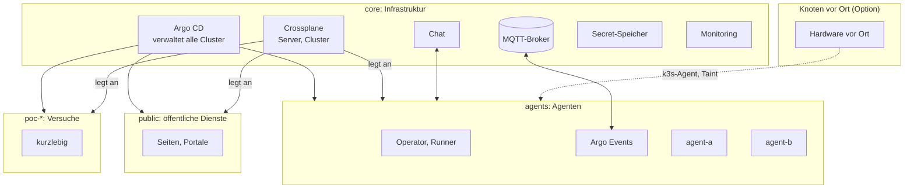

# 13 Cluster-Topologie

## Vorschlag

Ausblick, nicht gebaut. Mehrere kleine, gleichförmige Cluster statt eines großen. Jeder Cluster hat einen Zweck, eine eigene Fehlerdomäne und eigene Zugänge. Alle laufen gleich: Flatcar Linux (unveränderliches Betriebssystem mit automatischen Updates) und k3s.

| Cluster | Zweck | Warum getrennt |
| --- | --- | --- |
| core | Argo CD als Hub, Crossplane, Chat, Broker, Secret-Speicher, Monitoring | läuft immer, wenige Änderungen, hält die Schlüssel |
| agents | Operator, Argo Events, ein Namespace pro Agent | unvorhersagbare Arbeitslast, eigene Egress-Regeln, darf ausfallen ohne Webseiten mitzureißen |
| public | öffentlich erreichbare Dienste | andere Sicherheitsanforderungen |
| poc-* | Versuche, kurzlebig | wird regelmäßig weggeworfen |
| Knoten vor Ort (Option) | Hardware vor Ort (Netz, Geräte) | als Knoten des Agenten-Clusters mit Taint, nur für Agenten, die ihn brauchen. Risiko: Er öffnet Agenten den Weg ins lokale Netz; er braucht eine eigene NetworkPolicy und darf keine anderen Agenten aufnehmen |

## Warum Agenten einen eigenen Cluster bekommen

- **Andere Fehlerbilder.** Agenten erzeugen Last in Wellen, sprechen ins Internet und führen Code mit fremden Eingaben aus. Ein Ausbruch aus einem Container soll keine Webseite und keinen Secret-Speicher erreichen.
- **Andere Egress-Regeln.** Im Agenten-Cluster ist ausgehender Verkehr standardmäßig zu; im Web-Cluster wäre das unpraktisch.
- **Klare Rechte.** Wer Agenten betreut, braucht Zugriff auf diesen Cluster, nicht auf alle.

## Verbindungen zwischen den Clustern

| Von | Nach | Wofür | Absicherung |
| --- | --- | --- | --- |
| Argo CD (core) | agents, web, poc | Bereitstellung | Cluster-Zugang pro Ziel, nur Argo CD |
| Argo Events (agents) | Broker (core) | Ereignisse lesen | MQTT über WebSocket mit TLS, Benutzer mit Leserecht |
| Brücke (agents oder core) | Chat, Broker | Nachrichten mitlesen, veröffentlichen | Bot-Token, Broker-Benutzer mit Schreibrecht nur auf sein Topic |
| Schritt-Pods (agents) | Chat (core) | Antworten | Bot-Token, über Egress-Proxy |

## Stand

Die Topologie ist ein Vorschlag, gebaut wird sie nicht sofort. Der PoC läuft lokal auf Docker Desktop (Operator, Argo CD, Argo Events, Agenten), Broker und Chat auf einem vorhandenen k3s-Cluster. Der nächste Schritt ist ein eigener Agenten-Cluster mit k3s, sobald der PoC trägt; dort wirken auch die NetworkPolicies, die Docker Desktop nicht durchsetzt.
