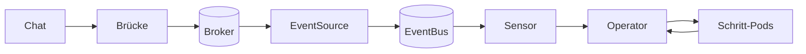

# 15 Betrieb und Pflege

## Images

| Image | Inhalt | Wer pflegt |
| --- | --- | --- |
| Runner | Runner-Binary für Agenten-Schritte und als Wrapper | Laufzeit |
| Runtime | generisches Image für Kommando-Schritte: Python, jq, Zeitzonen, Antwort-Skript | Agenten-Repository |
| Werkzeug-Image pro Agent | nur wenn ein Agent eigene Skripte braucht | Agenten-Repository, gebaut in der CI |
| Egress-Proxy | Squid | Hersteller (Canonical), Chart extern |
| Operator, Brücke | | Laufzeit |

Regeln:

- **Basis mit Sicherheitsupdates:** UBI oder Ubuntu-Rocks, regelmäßig neu gebaut.
- **Digest statt Tag im Betrieb.** Ein Tag wie `:dev` oder `:edge` kann sich ändern. Im Betrieb steht im Manifest ein Digest, oder die Laufzeit löst den Tag beim Start auf und hält den Digest im Lauf fest (G40). Renovate schlägt neue Digests als Pull Request vor.
- **Möglichst wenige Images.** Neue Agenten nutzen das Runtime-Image, solange sie keine eigenen Abhängigkeiten brauchen.

## Updates

| Teil | Wie | Wer prüft |
| --- | --- | --- |
| Betriebssystem der Knoten | Flatcar aktualisiert sich selbst, Neustart koordiniert | automatisch |
| Kubernetes (k3s) | Upgrade-Plan im Cluster | Betrieb |
| Operator, Argo Events, Argo CD | Chart-Version im GitOps-Repository, Renovate | Review |
| Images der Agenten | Renovate, CI baut, Digest im Manifest | Review |
| Modelle | Modellname im Manifest; neues Modell ist eine fachliche Änderung | Review mit Testlauf |
| Preise | Preistabelle der Laufzeit | Betrieb |

Ein Modellwechsel ist keine Kleinigkeit: Anweisungen, Kosten und Verhalten ändern sich. Vor dem Wechsel ein Testlauf gegen gespeicherte Eingaben (zum Beispiel Mocks der Webseiten im Agenten-Verzeichnis).

## Datensicherung

| Was | Wo | Sicherung |
| --- | --- | --- |
| Manifeste, Werte, Skripte | Git | Git |
| Zustand der Agenten | Zustands-Volumes | Volume-Sicherung des Clusters; Skripte legen vor dem Schreiben eine Kopie an |
| Läufe | Kubernetes | nicht gesichert, sind Geschichte; Audit-Ereignisse in der Protokollierung |
| Secrets | Secret-Speicher | Sicherung des Tresors |

## Typische Fehlerbilder

| Symptom | Ursache | Wo nachsehen |
| --- | --- | --- |
| Agent erscheint nicht nach dem Push | ApplicationSet folgt `main`, Push ging auf einen anderen Branch | Argo CD, Branch |
| Workflow `Valid=False` | Feld oder Funktion nicht unterstützt, Schema-Fehler | Condition am Workflow |
| Binding `Ready=False`, `StateVolume` | genanntes Volume fehlt | Binding-Status |
| Lauf `TriggerNotAllowed` | Sensor und Manifest passen nicht zusammen (Quelle, Typ, Index) | Lauf-Status, Sensor |
| Lauf `DuplicateEvent` | gewollt: zweite Zustellung desselben Ereignisses | nichts zu tun |
| Keine Antwort im Chat | Brücke nicht im Kanal, Filter passt nicht, Sensor verwirft | Brücke, Sensor-Protokoll |
| Kommando-Schritt erreicht Seite nicht | Domain fehlt in der Allowlist | Zugriffsprotokoll des Egress-Proxys (`TCP_DENIED`) |
| Lauf bricht ab mit Budget | Grenze erreicht | Kosten im Lauf, Audit |
| Keine Push-Nachricht | keine Erwähnung in der Nachricht | Push-Einstellungen, `@all` |

## Einen Agenten abschalten

Wichtig: Argo CD heilt selbst. Jede Änderung von Hand im Cluster (Policy ändern, Binding löschen) ist in Sekunden zurückgesetzt.

| Wie | Wirkung | Stand |
| --- | --- | --- |
| `suspend: true` in den Werten | nur Zeitpläne pausieren; Ereignis- und manuelle Läufe gehen weiter | umgesetzt |
| Sensor abschalten (`events.enabled: false`) | keine Ereignis-Läufe mehr | umgesetzt |
| Verzeichnis entfernen | Agent samt Namespace, Zustand und Secrets weg | umgesetzt |
| Notfall | Auto-Sync der Application abschalten, dann Binding löschen oder Policy ändern; danach den Zustand per Pull Request herstellen | umgesetzt (Argo CD) |
| Pause im Operator | eine Markierung an Binding oder Namespace, die neue Läufe aller Art ablehnt und laufende abbricht, ohne Git | geplant |

## Ausfälle

| Fällt aus | Wirkung | Wiederanlauf |
| --- | --- | --- |
| Chat | keine Ereignisse, keine Zustellung; Zustell-Schritte scheitern | Läufe neu starten |
| Brücke | Nachrichten in dieser Zeit gehen verloren (kein Nachholen) | Neustart; Nachholen über die Chat-API ist offen |
| Broker | wie Brücke; die Brücke puffert nicht | Neustart, Zustand des Brokers auf Volume |
| EventSource | Nachrichten gehen verloren (QoS 0) | Neustart |
| EventBus | Ereignisse zwischen EventSource und Sensor gehen verloren; mit einer Replika ist er ein Einzelpunkt | drei Replikas im Agenten-Cluster |
| Operator | Er ist Steuerung und Datenweg zugleich: Runner-API, Modell- und Tool-Proxy hängen an ihm. Laufende Schritte scheitern bei ihrem nächsten Aufruf; Zeitpläne holen verpasste Termine innerhalb von `startingDeadline` nach | Neustart; Hochverfügbarkeit (mehrere Replikas, Wahl eines Leiters, Proxy in allen Replikas) offen |
| Modell-Anbieter | Agenten-Schritte scheitern | Backoff geplant ([Kapitel 10](10-modelle-und-kosten.md#ratenlimits-und-ausfälle-des-anbieters)) |

Teilfehler im Lauf: Scheitert ein Zustell-Schritt (zum Beispiel Telegram), läuft der Schritt `remember` nicht, und am nächsten Tag wird alles erneut gemeldet, auch in die Kanäle, die geklappt haben. Ohne Schritte nach Fehlschlag (G13) hilft nur, Zustellung und Merken so zu schneiden, dass jeder Kanal seinen eigenen Stand merkt.

## Upgrade der Laufzeit

| Teil | Was zu beachten ist |
| --- | --- |
| Operator mit laufenden Läufen | Läufe sind auf ihr Manifest festgehalten; ein neuer Operator übernimmt sie. Tickets sind signiert; sie überleben einen Neustart nur, wenn der Signaturschlüssel fest konfiguriert ist (`AGENTABLE_TICKET_KEY`), sonst scheitern laufende Schritte. Sicherer Weg: Zeitpläne pausieren, laufende Läufe auslaufen lassen, dann aktualisieren |
| CRDs der Laufzeit (`v1alpha1`) | Helm aktualisiert CRDs nicht; sie werden getrennt angewendet. Bei Änderungen am Schema: Konvertierung oder Neuanlage der Bindings aus Git |
| AWP-Version (`v1alpha2` auf die nächste) | Manifeste im Repository auf einmal umstellen; der Operator muss beide Versionen eine Zeit lang lesen können |

## Mandanten und Rechte

Im PoC gibt es einen Betreiber und einen Benutzer. Mit mehreren Teams (offen):

- **Argo CD AppProject pro Team** mit den Namespaces seiner Agenten; CODEOWNERS pro Agenten-Verzeichnis und für die Plattform-Schlüssel der Werte.
- **Budgets pro Team**, Modell-Schlüssel oder Arbeitsbereich pro Team.
- **Wer darf Läufe anlegen:** RBAC für `WorkflowRun` pro Namespace; heute darf das jeder mit Schreibrecht im Namespace.
- **Personen statt Namen im Filter:** Erlaubte Benutzer stehen heute einzeln in jedem Agenten. Wer das Team verlässt, muss aus allen Agenten entfernt werden. Besser: Filter auf eine Gruppe im Chat, die die Brücke ins Ereignis schreibt.

## Datenschutz und Protokolle

| Daten | Wohin | Frage |
| --- | --- | --- |
| Chat-Nachrichten und Thread-Verlauf aller Teilnehmer | an den Modell-Anbieter; als Eingaben im `WorkflowRun`, also in etcd | Auftragsverarbeitung mit dem Anbieter, Region, Aufbewahrung beim Anbieter; `history.keep` als Löschfrist |
| Webseiteninhalte | an den Modell-Anbieter | unkritisch, wenn öffentlich |
| Profile, Vorlieben im Zustand | an den Modell-Anbieter | Zweck, Löschung |
| Zugriffsprotokolle des Squids (Ziele) | Pod-Logs | Aufbewahrungsfrist |
| Audit-Ereignisse | Pod-Logs, später zentrale Protokollierung | Aufbewahrungsfrist |

`classification` im Manifest beschreibt die Vertraulichkeit der Daten eines Workflows. Geplant ist, dass die Laufzeit sie gegen den Anbieter prüft (zum Beispiel: `confidential` nur an Anbieter mit Auftragsverarbeitung). Wohin Pod-Logs gehen und wie lange sie bleiben, legt der Betreiber fest (O08).
