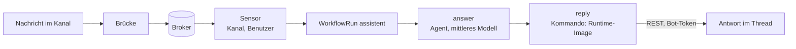

# Beispiel: Chat-Assistent

Ein allgemeiner Assistent in einem eigenen Chat-Kanal. Er antwortet auf jede Nachricht erlaubter Benutzer, im Thread der Nachricht, mit dem bisherigen Verlauf als Kontext. Er hat keine Werkzeuge, keinen Internetzugang und keine MCP-Server: Er redet nur.

## Ablauf



## Was dafür nötig ist

Ein Verzeichnis mit drei Dateien:

```yaml
# agents/assistent/agent.yaml
chart: mattermost-chat
```

```yaml
# agents/assistent/values.yaml
channel: assistent
users: [alice]
```

Dazu das Manifest `workflow.yaml` (siehe [Kapitel 03](03-workflow-manifest.md#beispiel)). Das Anwendungs-Chart `mattermost-chat` macht daraus:

- Namespace `agent-assistent` mit Pod Security `restricted`, NetworkPolicy im Modus `proxy` und einem Squid, der nur den Chat-Host durchlässt
- Binding mit dem Bot-Token als Secret für Kommando-Schritte
- Sensor mit dem Filter "Kanal `assistent`, Benutzer `alice`, jede Nachricht" und den Feldern als Inputs (Nachricht, Thread-Verlauf als JSON, Kanal, Thread)

Kein eigenes Image: Die Antwort stellt das generische Runtime-Image zu (`reply.py`).

## Was das Beispiel zeigt

- **Ein neuer Agent ist eine Datei-Änderung.** Drei Dateien, ein Push, nach rund 20 Sekunden antwortet der Assistent. Verzeichnis löschen, er ist weg.
- **Anwendungs-Charts kapseln Wissen.** Wer einen Chat-Agenten anlegt, schreibt "Kanal und Benutzer", nicht Sensor-Pfade.
- **Netz zu ist der Normalfall, aber nicht ganz.** Der Agenten-Schritt spricht nur mit dem Operator. Der Antwort-Schritt muss den Chat erreichen; im Modus `none` ginge das mit wirksamen NetworkPolicies nicht mehr. Das Anwendungs-Chart bringt deshalb einen eigenen Egress-Proxy mit dem Chat-Host als einziger Domain mit; der Namespace läuft im Modus `proxy`.
- **Kosten unter 0,02 USD pro Antwort.**
