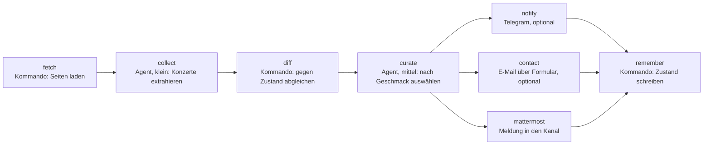
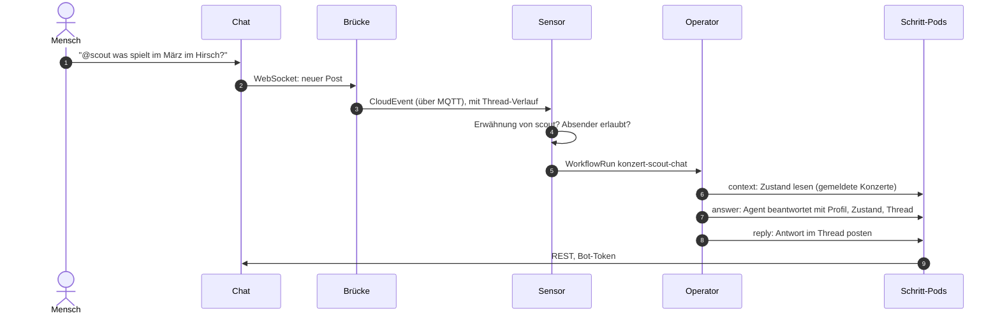

# Beispiel: Konzert-Scout

Ein Agent, der jeden Morgen die Programme bekannter Clubs abklappert, mit der eigenen Konzert-Historie vergleicht und neue, passende Konzerte meldet. Dazu ein zweiter Workflow, der Rückfragen im Thread der Meldung beantwortet. Beide teilen sich einen Zustand.

## Täglicher Lauf



| Schritt | Art | Was | Nach außen |
| --- | --- | --- | --- |
| fetch | Kommando (Werkzeug-Image) | lädt die Programmseiten, kennt drei Formate (HTML, JSON-API, eingebettete Daten) | Club-Seiten über den Egress-Proxy |
| collect | Agent, kleines Modell | macht aus dem Text eine Liste (Künstler, Datum, Ort, Link), lässt Nicht-Konzerte weg | nur Modell-Proxy |
| diff | Kommando | vergleicht mit `seen.json` im Zustand, gibt nur Neues weiter | nichts |
| curate | Agent, mittleres Modell | wählt nach der Konzert-Historie aus, formuliert die Meldung | Modell-Proxy; liest die Historie über `web.fetch` des Tool-Proxys |
| notify, contact, mattermost | Kommando | stellen zu, jeder Kanal einzeln abschaltbar | Telegram, Formular, Chat über den Egress-Proxy |
| remember | Kommando | schreibt das Gemeldete in den Zustand, mit Sicherung | nichts |

Ausgelöst um 7 Uhr (Zeitplan im Manifest, Zeitzone Europe/Berlin). Kosten pro Lauf 0,05 bis 0,28 USD, fast nur für den Kurator.

Im PoC laufen die Schritte mit Außenkontakt noch ohne Egress-Proxy; Werte und Chart sind vorbereitet (geplant). `web.fetch` des Kurators geht über den Tool-Proxy des Operators, nicht über den Squid ([Kapitel 08](08-isolation-und-netzwerk.md#der-operator-als-zweite-tür)).

## Rückfrage im Thread



- Zwei Routen im Sensor: Erwähnung des Bots, oder Antwort in einem Thread, in dem der Bot schon geschrieben hat. Beide nur für den erlaubten Benutzer.
- Ratenbegrenzung: zehn Läufe pro Minute.
- Der Chat-Workflow nutzt das Zustands-Volume des täglichen Workflows (`state.claimName`). Er liest die gemeldeten Konzerte und schreibt Wünsche aus dem Gespräch in eine Vorlieben-Datei, die der Kurator am nächsten Morgen liest; das ist bequem, aber ein Weg, das Gedächtnis zu vergiften ([Kapitel 11](11-zustand-und-kontext.md)).
- Kosten im PoC: 0,08 USD pro Antwort.

## Werte (gekürzt)

```yaml
workflows:
  - name: konzert-scout
    binding:
      suspend: false
      state: {size: 64Mi}
      secrets:
        - {name: CHAT_WEBHOOK, secretRef: {name: chat-webhook, key: url}}
  - name: konzert-scout-chat
    binding:
      state: {claimName: konzert-scout-state}
      secrets:
        - {name: CHAT_BOT_TOKEN, secretRef: {name: chat-bot, key: token}}
    events:
      enabled: true
      routes:
        - name: mention
          filters:
            - {path: body.data.mentions.#(=="scout"), value: scout}
            - {path: body.data.user, value: alice}
        - name: reply
          filters:
            - {path: body.data.threadUsers.#(=="scout"), value: scout}
            - {path: body.data.user, value: alice}
      rateLimit: {unit: Minute, requestsPerUnit: 10}
egress:
  mode: proxy
proxy:
  enabled: true
  allowedDomains: [.club-a.example, .club-b.example, chat.example.org, form.example.org, api.telegram.org]
```

## Was der Agent zeigt

- **Denken im Agenten, Handeln im Kommando:** Kein Agent hat einen Token. Zustellung und Zustand macht fester Code.
- **Billig, wo es geht:** Seiten laden und Abgleichen kostet nichts; das kleine Modell extrahiert, nur das mittlere bewertet.
- **Zustand als Vertrag zwischen Workflows:** Der Chat weiß, was gemeldet wurde.
- **Lücke G04:** Der Kurator läuft auch, wenn `diff` nichts Neues findet.
