# Einen neuen Agenten anlegen

## Ablauf

```mermaid
flowchart LR
    I[Anwendungsfall beschreiben] --> M[Assistent schreibt Manifest und Werte]
    M --> PR[Pull Request]
    PR --> CI[CI: Schema, Chart-Render, Tests]
    CI --> RV[Review: fachlich und Betrieb]
    RV --> MG[Merge auf main]
    MG --> AC[Argo CD legt Namespace und Agent an]
    AC --> T[Testlauf manuell]
    T --> ON[Zeitplan oder Sensor aktivieren]
```

1. **Beschreiben:** Was soll der Agent tun, wann, mit welchem Ergebnis, wohin? Welche Seiten oder Dienste braucht er?
2. **Manifest schreiben lassen:** Ein Assistent formuliert das AWP-Manifest nach dem Muster vorhandener Agenten. Grundsatz: Denken im Agenten, Handeln im Kommando.
3. **Werte festlegen:** Chart wählen (`agent` oder ein Anwendungs-Chart), Secrets zuordnen, Egress-Modus und Domains, Zustand, Ereignisse.
4. **Pull Request:** Die CI prüft Schema, Namen, Chart-Render und Tests der Skripte.
5. **Review auf zwei Ebenen:** fachlich (Anweisungen, Rechte, Budget, Modell) und Betrieb (Secrets, Egress-Domains, Zustand).
6. **Merge:** Argo CD legt alles an. Zeitpläne zuerst mit `suspend: true`.
7. **Testlauf:** `kubectl create` eines `WorkflowRun` mit Testeingaben, Ergebnis, Kosten und Proxy-Protokoll ansehen.
8. **Einschalten:** `suspend: false` oder Sensor aktivieren.

## Checkliste

| Frage | Wo |
| --- | --- |
| Hat jeder Agent ein Budget, hat der Workflow eine Dauer? | Manifest |
| Hat ein Agenten-Schritt Zugangsdaten? Dann umbauen. | Manifest |
| Bekommt nur ein Kommando-Schritt Secrets, mit `scope: [command]`? | Manifest |
| Ist `permissions.default: deny` gesetzt? | Manifest |
| Ist der Auslöser auf erlaubte Benutzer gefiltert? | Manifest, Werte |
| Stehen alle nötigen Domains in der Allowlist, und nur diese? | Werte |
| Braucht der Agent wirklich ein eigenes Image? | Agenten-Verzeichnis |
| Ist der Zustand gesichert, bevor er geschrieben wird? | Skripte |
| Gibt es Mocks oder Testdaten für einen Testlauf ohne echte Seiten? | Agenten-Verzeichnis |
